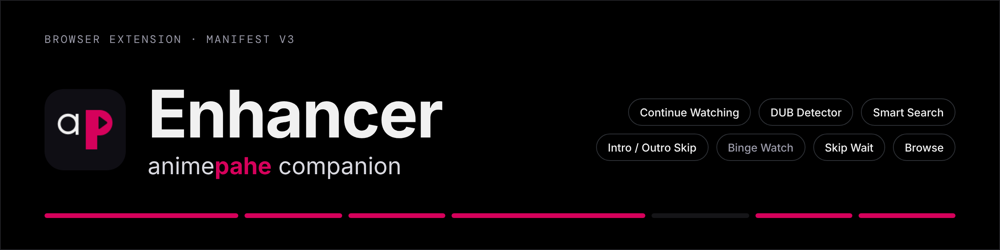
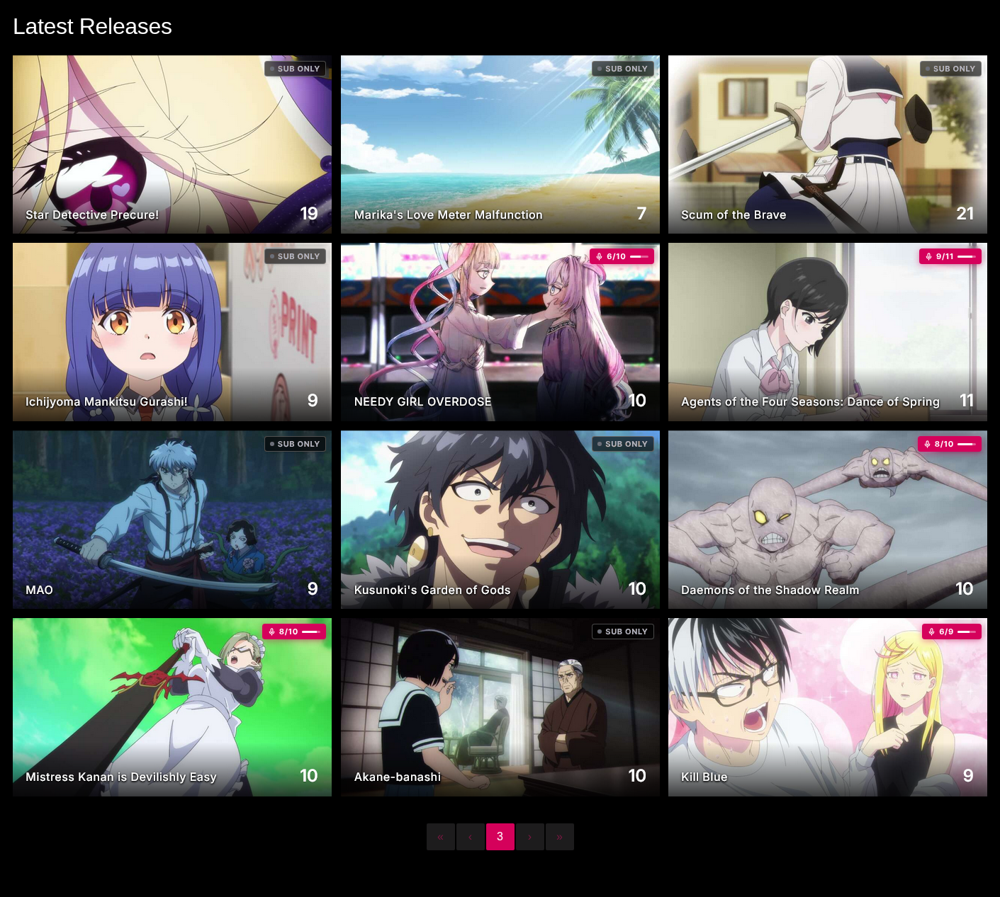
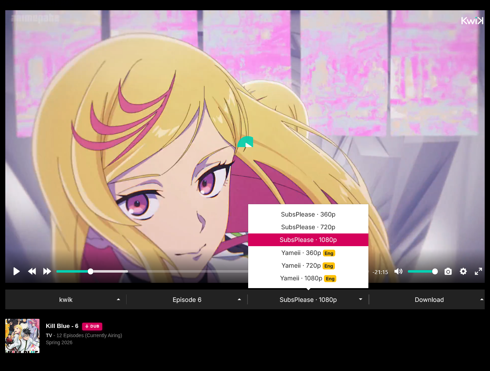
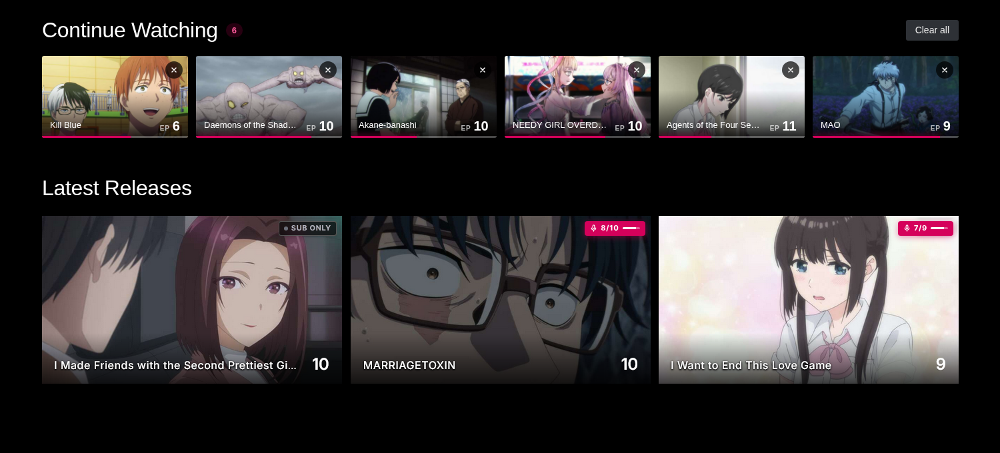
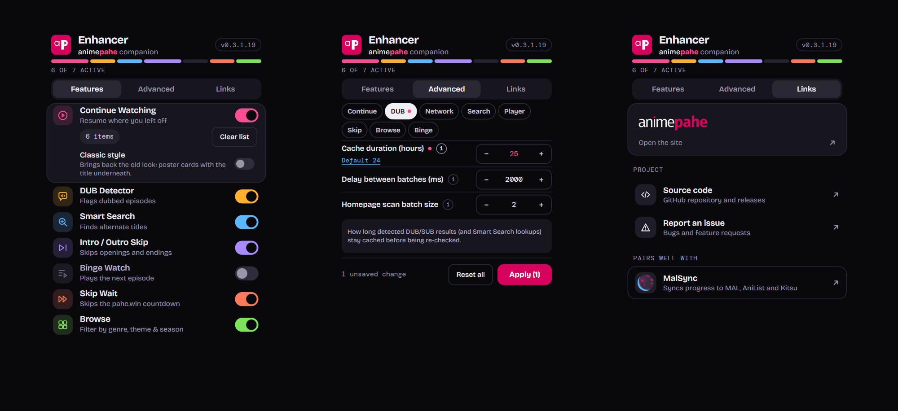
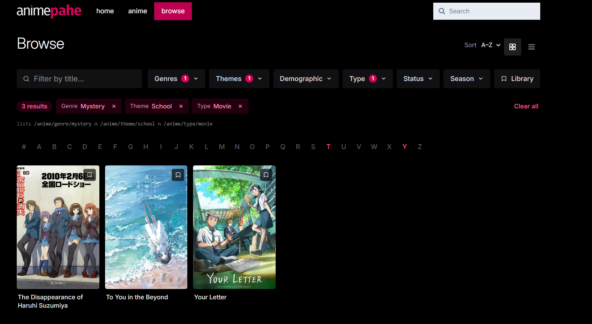

# animepahe Enhancer

A free browser extension that makes watching anime on animepahe a bit nicer. It
remembers where you left off, tells you which episodes are dubbed, helps you
find shows even if you only know a nickname for them, and can skip
openings/endings for you.

[![Firefox][badge-firefox]][firefox-add-ons] [![Edge][badge-edge]][edge-add-ons]
[![Manual install][badge-manual]][github-releases]
![Manifest V3][badge-manifest] [![License: MIT][badge-license]](LICENSE)
[![Version 0.3.1.20][badge-version]][release-tag]

[badge-firefox]: https://img.shields.io/badge/Firefox-Get_it_now-FF7139?style=flat-square&logo=firefoxbrowser&logoColor=white
[badge-edge]: https://img.shields.io/badge/Edge-Get_it_now-0078D7?style=flat-square&logo=microsoftedge&logoColor=white
[badge-manual]: https://img.shields.io/badge/Manual-Install-181717?style=flat-square&logo=github&logoColor=white
[badge-manifest]: https://img.shields.io/badge/Manifest-V3-4285F4?logo=googlechrome&logoColor=white
[badge-license]: https://img.shields.io/badge/License-MIT-green
[badge-version]: https://img.shields.io/badge/version-0.3.1.20-blue
[release-tag]: https://github.com/abdullahkhfb/animepahe-enhancer/releases/tag/v0.3.1.20
[firefox-add-ons]: https://addons.mozilla.org/en-US/firefox/addon/animepahe-enhancer/
[edge-add-ons]: https://microsoftedge.microsoft.com/addons/detail/omdenhapffjpbafkliiedijooomljbgd
[github-releases]: https://github.com/abdullahkhfb/animepahe-enhancer/releases

## Contents

*   [What it does](#what-it-does)
*   [Screenshots](#screenshots)
*   [Install](#install)
*   [Want more control?](#want-more-control)
*   [Contributing, privacy, and security](#contributing-privacy-and-security)
*   [See also](#see-also)

## What it does

*   **Continue Watching** — Picks up exactly where you stopped, every time, with
    a compact shelf of episode thumbnails (or the classic poster-card style,
    your choice), time-left badges, and progress bars on the home page.
    [Details](/docs/FEATURES.md#continue-watching)

*   **DUB Detector** — Flags dubbed and sub-only episodes with badges, home-card
    coverage meters, and an episode-list summary bar so you don't have to open
    an episode to find out. [Details](/docs/FEATURES.md#dub-detector)

*   **Smart Search** — Finds a show even if you search by an English title, a
    nickname, or a synonym in a different language via AniList.
    [Details](/docs/FEATURES.md#smart-search)

*   **Intro / Outro Skip** — Skips openings and endings automatically or with a
    one-click Skip button, and highlights intros, outros, and recaps on the
    player scrubber. [Details](/docs/FEATURES.md#intro--outro-skip)

*   **Binge Watch** — Auto-loads the video embed and plays the next episode when
    one ends, with a click-to-cancel countdown pill. Off by default.
    [Details](/docs/FEATURES.md#binge-watch)

*   **Skip Wait** — Download-menu links open the kwik page directly, skipping
    the 5-second `pahe.win` countdown page.
    [Details](/docs/FEATURES.md#skip-wait)

*   **Browse** — A native-feeling **browse** tab in the site menu that lets you
    combine genres, themes, demographics, types, status and seasons in one
    search, using animepahe's own lists. Remembers your filters and scroll
    position across reloads. [Details](/docs/FEATURES.md#browse) Each feature
    can be turned on or off separately from the extension's popup. Settings and
    watch progress stay in your browser; some features make the network requests
    they need to work. See the [privacy policy](PRIVACY.md) for exactly what
    leaves your device and why.

## Screenshots

## Install

Firefox and Edge are one click away; other Chromium browsers need a manual
install. Installs are free, take about 10 seconds, and need no account.

| Browser                    | Where to get it                    | Notes                                                                                    |
| -------------------------- | ---------------------------------- | ---------------------------------------------------------------------------------------- |
| **Firefox**                | [Firefox Add-ons][firefox-add-ons] | Ready to install right now                                                               |
| **Chrome**                 | Chrome Web Store                   | **Release date: TBA** — not submitted yet; Chrome Web Store review has not been tested   |
| **Edge**                   | [Edge Add-ons][edge-add-ons]       | Ready to install right now                                                               |
| Any other Chromium browser | [GitHub Releases][github-releases] | Manual install — see the [development guide](/docs/DEVELOPMENT.md#loading-the-extension-locally) |

## Want more control?

If you like tinkering, the popup has an **Advanced** tab where you can adjust
things like cache duration, scan speed, and skip timing — all with
plain-language descriptions, so you don't need to touch any code. Everything has
a sensible default, so this is entirely optional.
[See what's tunable →](/docs/FEATURES.md#advanced-settings)

## Contributing, privacy, and security

*   **Want to help?** Bug reports, ideas, and pull requests are all welcome —
    see the [contributing guide](CONTRIBUTING.md) for how to get started.
*   **Curious what data is involved?** See the [privacy policy](PRIVACY.md) —
    the short version is: your data stays on your device, and the few features
    that do talk to the internet are documented there.
*   **Found a security issue?** Please don't open a public issue — see
    [security policy](SECURITY.md) for how to report it privately.
*   **Community standards:** this project follows the
    [Code of Conduct](CODE_OF_CONDUCT.md).
*   **License:** [MIT](LICENSE) ©
    [abdullahkhfb](https://github.com/abdullahkhfb)

## See also

*   [Feature reference](/docs/FEATURES.md): the full technical and visual detail
    behind every feature.
*   [Usage guide](/docs/USAGE.md): step-by-step instructions for each feature
    and the popup.
*   [Architecture guide](/docs/ARCHITECTURE.md): how the code is organized, and
    how to add a feature or setting.
*   [Permissions guide](/docs/PERMISSIONS.md): what the extension can access,
    and why.
*   [Development guide](/docs/DEVELOPMENT.md): running the extension locally and
    how releases are published.
*   [Edge listing guide](/docs/EDGE.md): the state of the Microsoft Edge
    listing, and how to install anyway.
*   [Release notes](/RELEASE.md): every version, mirrored from GitHub Releases.
*   [Store listing text](/docs/STORE_LISTING.md): the description used on the
    store listings.
