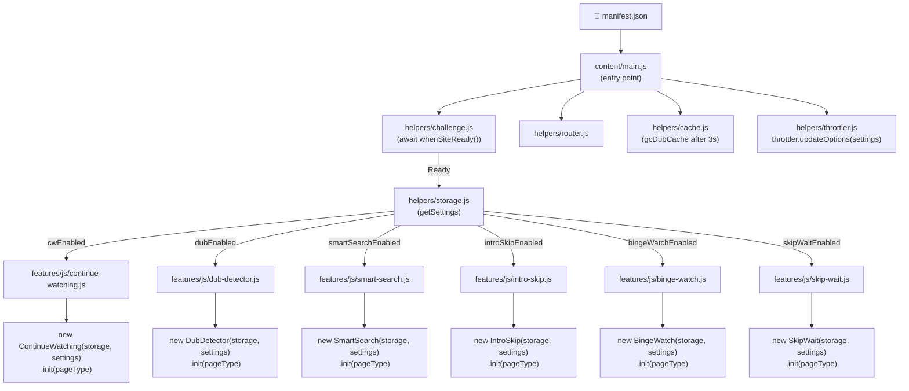
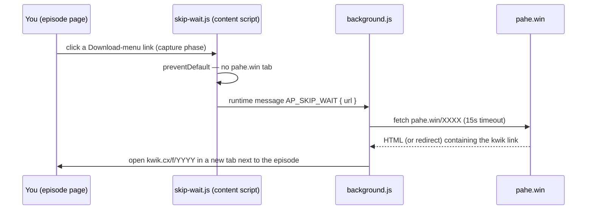
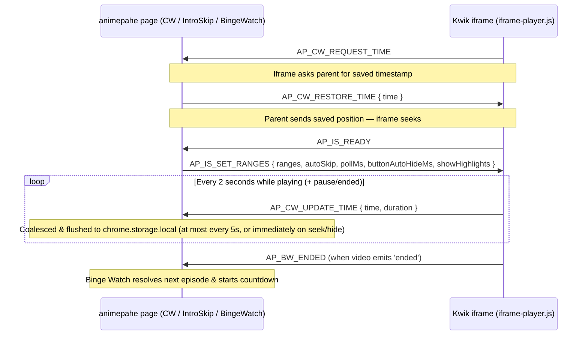
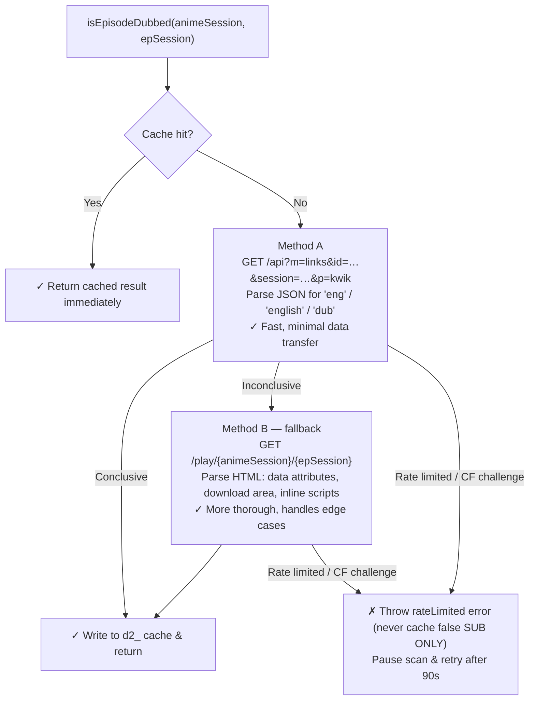
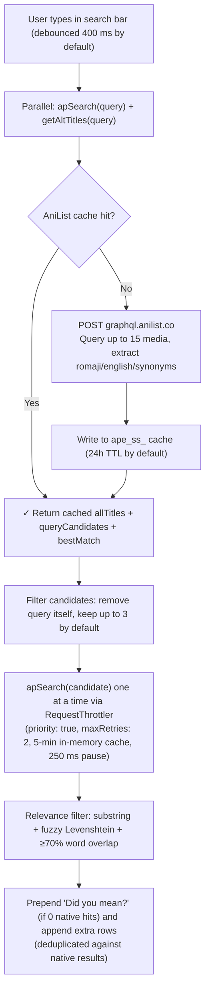

<a name="top"></a>

# Architecture

> How the codebase is put together. For a plain-language overview, see the [main README](../README.md), or see [docs/FEATURES.md](FEATURES.md) for feature-by-feature behaviour.

## Table of Contents

- [File Structure](#file-structure)
- [How It Works](#how-it-works)
- [Adding a New Feature](#adding-a-new-feature)
- [Adding an Advanced Setting](#adding-an-advanced-setting)
- [Adding a Sub-Feature](#adding-a-sub-feature)

---

## File Structure

```
📦 animepahe-enhancer/
├── ⚙️  manifest.json              # Extension manifest (Manifest V3) — Firefox build
├── ⚙️  manifest.chromium.json     # Same manifest for Chrome / Edge: only `background` differs
├── 📄 background.js               # Background script (service worker / event page) —
│                                  #   Skip Wait: resolves pahe.win → kwik and opens the tab
│
├── 📁 content/
│   ├── 📄 main.js                 # Entry point — waits for whenSiteReady(), loads settings,
│   │                              #   detects page, dynamically imports and initializes features
│   ├── 🎨 main.css                # Shared base styles (status toast: plain + rich states)
│   ├── 📄 iframe-player.js        # Kwik iframe script — ensurePlayback() + postMessage bridge for
│   │                              #   Continue Watching, Intro/Outro Skip, and Binge Watch (ended)
│   │
│   ├── 📁 features/               # Feature modules, with optional stylesheets,
│   │   │                          #   kept in separate css/ and js/ folders
│   │   ├── 📁 js/
│   │   │   ├── 📄 continue-watching.js  # Continue Watching — home shelf, snapshot harvester, player bridge
│   │   │   ├── 📄 dub-detector.js       # DUB Detector — badges, summary bar, gallop+binary search, cache
│   │   │   ├── 📄 smart-search.js       # Smart Search — AniList alt-title lookup + dropdown injection
│   │   │   ├── 📄 intro-skip.js         # Intro/Outro Skip — timestamp lookup + range orchestration
│   │   │   ├── 📄 binge-watch.js        # Binge Watch — auto-loads embed + auto-plays next episode
│   │   │   └── 📄 skip-wait.js          # Skip Wait — download links bypass the pahe.win countdown page
│   │   └── 📁 css/
│   │       ├── 🎨 continue-watching.css
│   │       ├── 🎨 dub-detector.css
│   │       ├── 🎨 intro-skip.css        # Also loaded inside the kwik iframe (see iframe-player.js)
│   │       └── 🎨 binge-watch.css
│   │
│   └── 📁 helpers/                # Shared helpers imported by any feature
│       ├── 📄 storage.js          # chrome.storage.local wrapper + KEYS + DEFAULT_SETTINGS
│       │                          #   + ADVANCED_SETTINGS_SCHEMA + FEATURE_SUBOPTIONS
│       ├── 📄 router.js           # Page-type and session ID detection from the current URL
│       ├── 📄 challenge.js        # isChallengePage() + whenSiteReady() — stays idle on Cloudflare
│       │                          #   interstitials and waits for page load before starting features
│       ├── 📄 cache.js            # Shared TTL cache read/write/GC (d2_, h2_, ape_ss_, ape_isid_)
│       ├── 📄 throttler.js        # RequestThrottler — concurrency, interval+jitter, priority queue,
│       │                          #   exponential backoff on 429/403, 60s pause on CF challenges
│       ├── 📄 icons.js            # Shared inline-SVG factory (micIcon, checkIcon, playIcon, closeIcon)
│       ├── 📄 styles.js           # injectStylesheet() — one-line CSS loading, shared by every feature
│       ├── 📄 pill.js             # showPill() (plain text) + showStatus() (rich toast with progress
│       │                          #   ring, pink check icon, or amber dot)
│       └── 📄 timestamps-db.js    # open-anime-timestamps dataset access (IndexedDB cache, ETag refresh,
│                                  #   AniList → relations.yuna.moe → AniDB ID resolution, episode lookup)
│
├── 📁 popup/                      # The toolbar popup — built from small components
│   ├── 🌐 popup.html              # Empty shell: stylesheets + <div id="app">
│   ├── 📄 popup.js                # Entry point — mounts the header, timeline strip,
│   │                              #   tab bar and the three tab panels
│   ├── 📁 components/             # One file per component, grouped by role
│   │   ├── 📄 dom.js              #   h() element builder shared by every component
│   │   ├── 📁 icons/              #   One file per icon (and per real logo image)
│   │   │   ├── 📄 ContinueWatchingIcon.js, DubDetectorIcon.js, SmartSearchIcon.js,
│   │   │   │      IntroSkipIcon.js, BingeWatchIcon.js,
│   │   │   │      SkipWaitIcon.js                         # the six feature icons
│   │   │   ├── 📄 SourceCodeIcon.js, ReportIssueIcon.js, ExternalLinkIcon.js
│   │   │   ├── 📄 ApMark.js       #   The extension's logo tile
│   │   │   ├── 📄 SiteLogo.js     #   Real animepahe wordmark (icons/animepahe-wordmark.svg)
│   │   │   ├── 📄 MalSyncLogo.js  #   Real MalSync logo (icons/malsync.svg)
│   │   │   ├── 📄 svg.js          #   SVG helpers (line-icon frame, path/circle)
│   │   │   └── 📄 index.js        #   Single import point for all icons
│   │   ├── 📁 ui/                 #   Toggle, Button, StatChip, Stepper, Notice
│   │   ├── 📁 layout/             #   Header, Timeline (status strip), Tabs
│   │   ├── 📁 features/           #   FeatureRow + feature-config.js (name, colour, icon)
│   │   ├── 📁 advanced/           #   SettingRow, GroupChips
│   │   └── 📁 links/              #   LinkRow, SiteCard
│   ├── 📁 scripts/                # Data wiring — connects components to storage
│   │   ├── 📄 common.js           #   Button feedback shared by every tab (DRY)
│   │   ├── 📄 features.js         #   Features tab: toggles, stats, clear actions
│   │   ├── 📄 advanced.js         #   Advanced tab: staged edits, Apply, Reset all
│   │   └── 📄 links.js            #   Links tab
│   ├── 📁 styles/                 # Design tokens + one stylesheet per concern
│   │   ├── 🎨 tokens.css          #   Fonts, colours, reset, base
│   │   ├── 🎨 components.css      #   Toggle, buttons, stepper, notice
│   │   ├── 🎨 layout.css          #   Header, timeline strip, tabs, panels
│   │   ├── 🎨 features.css
│   │   ├── 🎨 advanced.css
│   │   └── 🎨 links.css
│   └── 📁 fonts/                  # Bricolage Grotesque + DM Mono (OFL), bundled offline; licence .txt files stay in the repo but are left out of builds
│
├── 📁 icons/
│   ├── 🖼️  icon16.png             # Toolbar / store icons (the "ap" mark)
│   ├── 🖼️  icon48.png
│   ├── 🖼️  icon128.png
│   ├── 🖼️  animepahe-wordmark.svg # The real animepahe site logo (Links tab)
│   └── 🖼️  malsync.svg            # The real MalSync logo (Links tab)
│
├── 📁 docs/                       # Detailed documentation (this file lives here)
│   ├── 📁 assets/                 # Feature & UI badge SVGs used across Markdown docs
│   └── 📁 widgets/                # Reusable install-prompt snippets for README.md
│
└── 📁 .github/
    ├── 📁 actions/
    │   └── 📁 build-zip/             # Composite action: single source of truth
    │       └── ⚙️  action.yml        #   for the store-zip exclusion list
    └── 📁 workflows/
        ├── ⚙️  deploy-firefox.yml    # Auto-deploys to Firefox on release publish
        └── ⚙️  deploy-edge.yml       # Manual-only deploy to Edge (workflow_dispatch)
```

<p align="right"><a href="#top">↑ Back to top</a></p>

## How It Works

### Module loading — no bundler required

`content/main.js` is the sole content-script entry point for animepahe pages registered in `manifest.json` (the only other scripts are `content/iframe-player.js` for the Kwik iframe and `background.js`, described under [Skip Wait](#skip-wait--background-flow)). It uses the browser's native dynamic `import()` with `chrome.runtime.getURL()` to load helper and feature modules at runtime — after verifying via `helpers/challenge.js` (`whenSiteReady()`) that the page is not a Cloudflare interstitial and has finished loading:



Feature files are listed in `web_accessible_resources` so the extension runtime can import them. No bundler, no build step — plain ES2020+ modules. Every feature constructor receives the same `settings` object (loaded once via `storage.getSettings()`), so reading a user-tuned value is just `settings.someKey ?? someDefault`.

### Skip Wait — Background Flow

Skip Wait is the one feature that needs a background script, because a content script on animepahe can't read another origin's page (`pahe.win`) — the extension's own background context can, via the `*://*.pahe.win/*` host permission.



- `background.js` is a classic script (no ES modules). Firefox only runs it from `background.scripts` (`manifest.json`); Chrome and Edge only accept `background.service_worker` in Manifest V3 and warn about `scripts` (`manifest.chromium.json`). That's why there are two manifests — everything else in them is identical, and the release build picks the right one.
- It only accepts `https://*.pahe.win/<id>` URLs — it is deliberately not a generic "fetch any URL" proxy.
- If no kwik link is found in the page (or the fetch times out after 15 seconds), it opens the original `pahe.win` URL so the click still does something.
- Ctrl / Shift / Alt / Cmd-clicks and middle-clicks are ignored by `skip-wait.js`, so the original behaviour is always one modifier key away.

### Cross-Frame Player Communication (`iframe-player.js`)

animepahe embeds the actual video player in a sandboxed `<iframe>` served from a separate domain (`kwik.cx`). Because the iframe and the parent page are on different origins, direct DOM access is impossible. The extension bridges the parent page (`continue-watching.js`, `intro-skip.js`, `binge-watch.js`) and the Kwik iframe (`iframe-player.js`) with `window.postMessage`:



**Message types:**

| Type                 | Direction       | Payload                                                          | Description                                                                 |
| -------------------- | --------------- | ---------------------------------------------------------------- | --------------------------------------------------------------------------- |
| `AP_CW_REQUEST_TIME` | iframe → parent | —                                                                | Iframe asks parent for saved timestamp on player load                       |
| `AP_CW_RESTORE_TIME` | parent → iframe | `{ time: number }`                                               | Parent sends saved position; iframe seeks `<video>`                         |
| `AP_CW_UPDATE_TIME`  | iframe → parent | `{ time, duration }`                                             | Iframe reports current playback position every `playerUpdateInterval` ms    |
| `AP_IS_SET_RANGES`   | parent → iframe | `{ ranges, autoSkip, pollMs, buttonAutoHideMs, showHighlights }` | Parent sends intro/outro/recap skip ranges and settings to iframe           |
| `AP_IS_SEEK`         | parent → iframe | `{ time: number }`                                               | Parent instructs iframe to seek (reserved)                                  |
| `AP_IS_READY`        | iframe → parent | —                                                                | Iframe signals it is ready to receive skip ranges                           |
| `AP_BW_ENDED`        | iframe → parent | —                                                                | Fired on every `<video>` `ended` event; `binge-watch.js` handles navigation |

<p align="right"><a href="#top">↑ Back to top</a></p>

### DUB Detector — Gallop-Then-Binary-Search

Dubbed episodes on animepahe occupy a **contiguous leading block** (episodes 1, 2, 3 … K are dubbed; K+1 … N are sub-only). After checking the first and last episodes concurrently, `_findBoundaryConcurrent()` gallops backward from the newest episode in doubling strides (`1, 2, 4, 8…`) one request at a time to bracket the cutoff, then binary-searches within that bracket one request at a time. This takes **O(log n)** API calls without firing parallel probe bursts.

Detection for a single episode uses two methods tried in sequence:



<p align="right"><a href="#top">↑ Back to top</a></p>

### Storage Schema

All settings and cache data are stored in `chrome.storage.local`. The large `open-anime-timestamps` database is stored in **IndexedDB** (see the [Intro / Outro Skip](FEATURES.md#-intro--outro-skip) section).

| Key                     | Type                  | Description                                                                                                                                                                                                                                                                                                                                    |
| ----------------------- | --------------------- | ---------------------------------------------------------------------------------------------------------------------------------------------------------------------------------------------------------------------------------------------------------------------------------------------------------------------------------------------- |
| `ape_settings`          | `object`              | Feature toggles, feature sub-options, and Advanced Settings values (cache TTL, throttling, batch sizes, debounce timings, skip durations, etc.). The full list of keys, labels, bounds, and defaults lives in `ADVANCED_SETTINGS_SCHEMA` and `FEATURE_SUBOPTIONS` in `content/helpers/storage.js`.                                                    |
| `ape_cw_v1`             | `string` (JSON array) | Continue Watching list — one entry per anime series in most-recently-watched order, up to 24 entries by default (`cwMaxEntries`). Writes are coalesced to at most every 5 seconds (or immediately on seek, episode change, or tab hide/close).                                                                                                          |
| `ape_cw_snaps`          | `object`              | LRU map of up to 300 `{ [epSession]: snapshotUrl }` pairs harvested passively from `/play/` links as you browse animepahe listings, allowing Continue Watching cards to display episode stills with zero extra network requests.                                                                                                                       |
| `d2_{epSession}`        | `string`              | DUB result cache for a single episode. Format: `"{timestamp}\|v1\|{JSON payload}"`                                                                                                                                                                                                                                                             |
| `h2_{animeSession}`     | `string`              | DUB stats cache (`{ dubs, total }`) for a home card. Format: `"{timestamp}\|v1\|{JSON payload}"`                                                                                                                                                                                                                                               |
| `ape_ss_{query}`        | `string`              | Smart Search AniList cache for a normalised query. Format: `"{timestamp}\|v1\|{JSON payload}"` storing `{ allTitles, queryCandidates, bestMatch }`.                                                                                                                                                                                           |
| `ape_isid_v1_{session}` | `string`              | Intro Skip ID resolution cache — maps an animepahe `animeSession` to its resolved `{ anidbId, anilistId, idMal }`. Format: `"{timestamp}\|v1\|{JSON payload}"`. TTL is configurable (`introSkipIdCacheHours`, default 168 hours / 7 days).                                                                                                    |
| `ape_is_db_meta`        | `object`              | Metadata for the `open-anime-timestamps` database cached in IndexedDB (`ape_intro_skip`): `{ fetchedAt, sizeBytes, etag }`. Shared between the content script and popup so the popup can display cache status and trigger invalidation across origins.                                                                                                  |

Entries prefixed `d2_`, `h2_`, and `ape_ss_` use the same configurable 24-hour default TTL (`cacheTtlHours`). Expired DUB entries (`d2_` and `h2_`) are garbage-collected 3 seconds after page startup (`gcDubCache`); expired Smart Search entries are ignored on lookup and removed when cleared from the popup. The Intro Skip ID cache (`ape_isid_`) has its own independent TTL (7 days by default), and the timestamps database in IndexedDB is refreshed via conditional GET (`If-None-Match` ETag) on a separate configurable schedule (`introSkipDbRefreshHours`, 7 days by default).

<p align="right"><a href="#top">↑ Back to top</a></p>

### Smart Search — AniList Alt-Title Lookup

Smart Search enriches the native animepahe dropdown by resolving alternative titles through the AniList GraphQL API:



Key design decisions:

- **Debounce (400 ms by default, configurable via `ssDebounceMs`)** prevents API calls while the user is actively typing.
- **Throttled + cached animepahe search (`apSearch`)** routes `/api?m=search` requests through `throttler.fetch(..., { priority: true, maxRetries: 2 })` and caches responses in memory (`apCache`) for 5 minutes so backspacing or retyping never re-queries the server.
- **Normalisation** (`norm()`) strips punctuation and lowercases before any comparison.
- **Relevance filter** (`isRelevant()`) uses title substring inclusion, Levenshtein fuzzy similarity (`<= 25%` edit distance), and requires at least 70% overlap of alternate-title words for its word-overlap match.
- **Deduplication** suppresses any result whose normalised title or session already appears in the native dropdown.
- **Stale-query guard** — if the input changes while awaiting AniList or between synonym lookups, the stale run aborts immediately without making further requests.

<p align="right"><a href="#top">↑ Back to top</a></p>

### RequestThrottler

All outbound extension requests to animepahe's `/api` — across **DUB Detector**, **Smart Search** (`apSearch`), **Continue Watching** (`_lookupOne`), and **Binge Watch** (`_findNextEpisodeSession`) — are routed through `helpers/throttler.js`, which exports a shared `throttler` singleton (and the `RequestThrottler` class). It provides:

- **Concurrency cap** — limits simultaneous in-flight fetches (`maxConcurrent`, default 6)
- **Interval + jitter** — enforces a minimum gap (`minInterval`, default 120 ms) between request launches with `± jitter` (default 50 ms) random variation to avoid burst patterns
- **Priority queue support** — `throttler.fetch(url, wantJson, { priority: true, maxRetries: 2 })` lets interactive user actions (like Smart Search) jump to the front of `_queue` ahead of background DUB scans
- **Exponential back-off on rate limits (HTTP 429/403)** — re-queues the request (up to `maxRetries`, default 4) and pauses the drain loop for `Math.max(retryAfterMs, baseBackoff × 2ⁿ + jitter)` (where `baseBackoff` defaults to 3,000 ms)
- **Cloudflare challenge pause (no retry)** — when a response is a Cloudflare challenge (HTTP 503 with Cloudflare HTML, or HTTP 200 returning Cloudflare HTML when JSON was expected), the request is **not** retried (which would only add load); it rejects immediately with `isCfChallenge: true` and pauses the entire queue for **60 seconds**
- **`pendingCount` getter** — used by the DUB Detector's status toast to display live scan progress
- **`updateOptions(opts)`** — applies new values to the live singleton without dropping anything already queued or in-flight; `main.js` calls this once on startup with the user's Advanced Settings → Network Throttler values

<p align="right"><a href="#top">↑ Back to top</a></p>

## Adding a New Feature

1. Create `content/features/js/my-feature.js` and export a class that satisfies the feature contract:

```js
export class MyFeature {
  constructor(storage, settings) {
    /* settings is the fully-merged object from storage.getSettings() */
  }
  async init(pageType) {
    /* ... */
  }
}
```

2. If it needs any styling, give it its own `content/features/css/my-feature.css` and inject it from `init()` using the shared helper (don't hand-roll a `<style>` tag or reuse another feature's CSS file):

```js
import { injectStylesheet } from "../../helpers/styles.js";
// ...
injectStylesheet("ape-mf-styles", "content/features/css/my-feature.css");
```

The existing `web_accessible_resources` globs already cover files in these feature and helper folders; check that both manifests continue to expose any new module or stylesheet. Anything the new feature's CSS has in common with another feature's belongs in `content/main.css` instead (loaded once by `main.js`), not copy-pasted — same goes for the shared status pill (`content/helpers/pill.js`) and shared on-page SVG icons (`content/helpers/icons.js`).

3. Add a settings key and default in `content/helpers/storage.js`:

```js
export const DEFAULT_SETTINGS = {
  cwEnabled: true,
  dubEnabled: true,
  smartSearchEnabled: true,
  introSkipEnabled: true,
  bingeWatchEnabled: false,
  skipWaitEnabled: true,
  myFeatureEnabled: true, // ← add here
  ...FEATURE_SUBOPTIONS_DEFAULTS,
  ...ADVANCED_DEFAULTS,
};
```

4. Register the feature in `content/main.js`:

```js
const FEATURES = [
  // ...existing entries...
  {
    module: "content/features/js/my-feature.js",
    export: "MyFeature",
    enabled: settings.myFeatureEnabled,
  },
];
```

5. Give it a row in the popup, with no markup to write:
   - Add an icon component, e.g. `popup/components/icons/MyFeatureIcon.js` (copy `BingeWatchIcon.js`; they are all a few lines) and export it from `popup/components/icons/index.js`.
   - Add an entry to `FEATURES` in `popup/components/features/feature-config.js` — `id`, `settingKey`, `name`, `desc`, `color`/`tint`, timeline `weight` and the `Icon`. The row, its switch and its segment in the status strip are generated from that.
   - If it has a cache to show or clear, add a `read()`/`clear()` pair for its `id` in `STATS` in `popup/scripts/features.js`.

If any of the feature's toggleable options are everyday options rather than tuning knobs, give it entries in `FEATURE_SUBOPTIONS` (see below) instead of `ADVANCED_SETTINGS_SCHEMA` — they'll render right on the feature's own card.

<p align="right"><a href="#top">↑ Back to top</a></p>

## Adding an Advanced Setting

The Advanced tab in the popup isn't hand-written markup — it's generated entirely from one schema, so adding a new tunable doesn't touch `popup.html` or any popup CSS/JS.

1. Add an entry to `ADVANCED_SETTINGS_SCHEMA` in `content/helpers/storage.js`, under an existing `group` or a new one:

```js
{
  key: "myNewTunable",
  label: "My new tunable",
  desc: "What this controls, in plain language.",
  min: 0,
  max: 100,
  step: 1,
  default: 10,
}
```

2. Read it wherever it's needed, with a fallback to that same default:

```js
this._myValue = settings.myNewTunable ?? 10;
```

The popup automatically renders a labeled stepper, an info button for the description, and its own **Default N** reset button for the new setting, and folds it into **Reset all** — for free.

<p align="right"><a href="#top">↑ Back to top</a></p>

## Adding a Sub-Feature

Sub-features are toggleable options that belong to a specific feature but aren't "advanced" (no timing/caching/request tuning) — they render directly on that feature's own card in the popup instead of the Advanced Settings tab. Add an entry to `FEATURE_SUBOPTIONS` in `content/helpers/storage.js`, keyed by the feature card's id (`dub`, `is`, `bw`, ...):

```js
export const FEATURE_SUBOPTIONS = {
  dub: [
    {
      key: "dubHomeScanEnabled",
      label: "Scan homepage cards",
      note: "Also checks homepage cards for dub status, not just episode lists. Off = fewer requests.",
      default: true,
    },
  ],
};
```

`popup/scripts/features.js` renders every row's list generically (through `FeatureRow`), so no popup markup or JS needs to change. Read the setting in the feature module the same way as any other: `settings.dubHomeScanEnabled !== false`.

<p align="right"><a href="#top">↑ Back to top</a></p>
