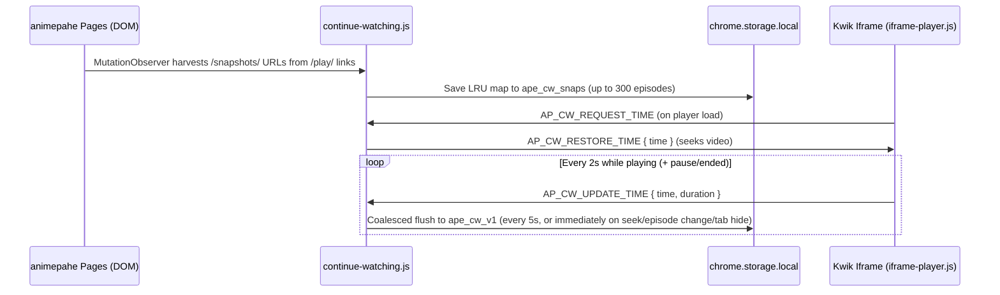
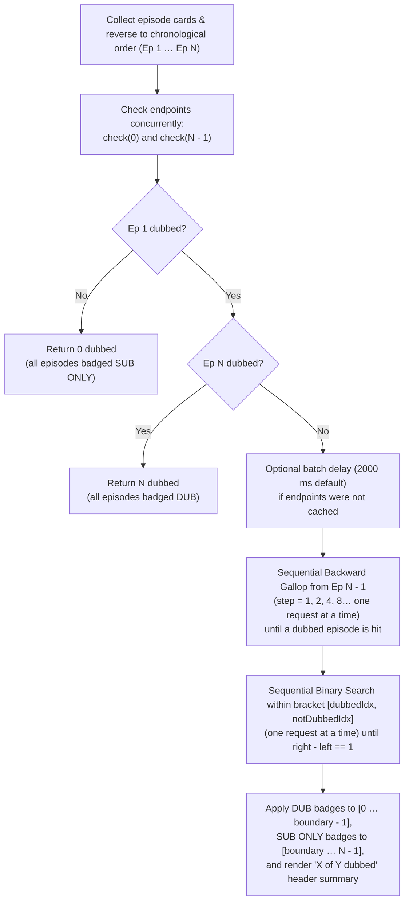
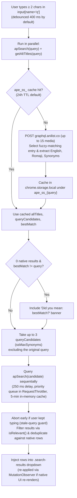
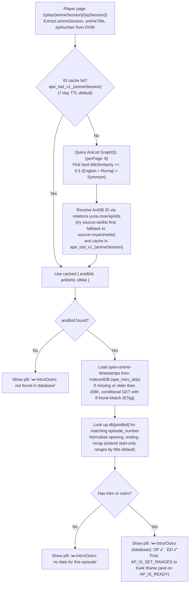
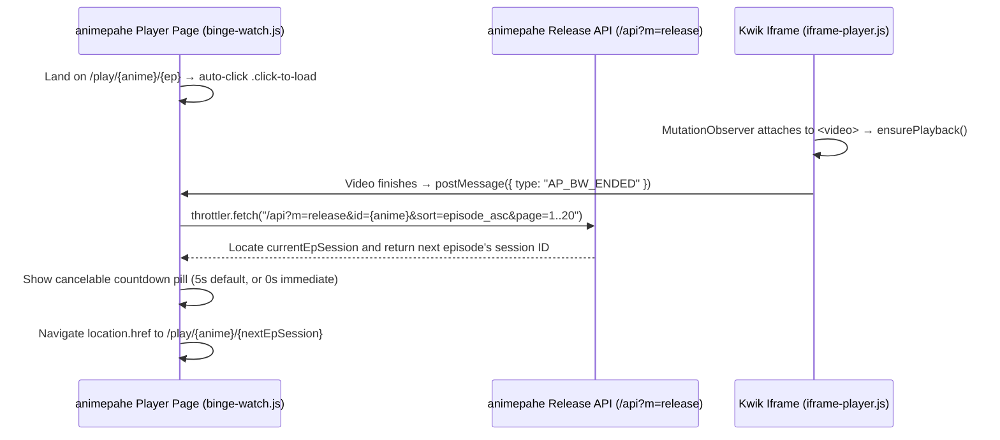

# Features (in depth)

> This page has the full technical and visual detail for every feature in **animepahe Enhancer**. If you just want the short overview, see the [main README](../README.md#what-it-does), or see the [Usage Guide](USAGE.md) for step-by-step instructions.

## Table of Contents

- [At a Glance](#at-a-glance)
- [Continue Watching](#-continue-watching)
- [DUB Detector](#-dub-detector)
- [Smart Search](#-smart-search)
- [Intro / Outro Skip](#-intro--outro-skip)
- [Binge Watch](#-binge-watch)
- [Skip Wait](#-skip-wait)
- [Cloudflare & Rate-Limit Protection](#-cloudflare--rate-limit-protection)
- [Advanced Settings](#-advanced-settings)

---

## At a Glance

Every feature is a self-contained ES module loaded dynamically by `content/main.js` only when enabled in the popup. Each feature has its own colour-coded SVG icon (`popup/components/icons/`) and proportional segment in the popup's status timeline strip:

| Icon | Feature | Default | Active Pages | Popup Sub-Options | Storage / Cache Keys |
| :---: | :--- | :---: | :--- | :--- | :--- |
|  | **[Continue Watching](#-continue-watching)** | **On** | Home (`/`) · Player (`/play/…`) · All pages (snapshot harvesting) | `Classic style` (**Off**) | `ape_cw_v1` · `ape_cw_snaps` |
|  | **[DUB Detector](#-dub-detector)** | **On** | Episode list (`/anime/…`) · Home (`/`) · Player (`/play/…`) | `Scan homepage cards` (**On**) | `d2_{epSession}` · `h2_{animeSession}` |
|  | **[Smart Search](#-smart-search)** | **On** | All pages with search bar (`input[name="q"]`) | — | `ape_ss_{query}` · 5-min in-memory `apCache` |
|  | **[Intro / Outro Skip](#-intro--outro-skip)** | **On** | Player (`/play/…`) + Kwik iframe (`kwik.cx`) | `Auto-skip automatically` (**Off**) · `Highlight on progress bar` (**On**) | `ape_isid_v1_{session}` · `ape_is_db_meta` · IndexedDB `ape_intro_skip` |
|  | **[Binge Watch](#-binge-watch)** | **Off** | Player (`/play/…`) + Kwik iframe (`kwik.cx`) | — | — |
|  | **[Skip Wait](#-skip-wait)** | **On** | Player (`/play/…`) + Background worker (`pahe.win`) | — | — |

<a href="#top">↑ Back to top</a>

---

##  Continue Watching

Never lose your place again. **Continue Watching** tracks your exact playback position for every anime you watch inside the embedded Kwik video player and surfaces a native-looking **Continue Watching** shelf directly above **Latest Releases** on the animepahe home page.

### Shelf & Card Anatomy

The Continue Watching shelf (`#ape-cw-section`) dynamically inspects animepahe's own **Latest Releases** heading and card grid at runtime (`_matchSite()`) — copying its exact typography, left/right alignment bounds, grid gap (`--ape-cw-gap`), and border radius (`--ape-cw-radius`) and re-aligning automatically on window resize, font load, or late DOM updates. Two styles are available, switched by the **Classic style** sub-option in the popup (`cwClassicLayout`, **Off** by default, applies live without a reload; the heading typography is only copied from the site in the default style):

- **Default** — a single row of **6** small 16:9 episode thumbnails (**4** at `≤ 1100px`, **3** at `≤ 780px`, **2** at `≤ 520px`), with the remove (✕) button always visible. This is the layout shown in the README screenshot.
- **Classic style** — the older look, switched on with the **Classic style** option in the popup (off by default): small portrait poster cards in a row with the title in a bar underneath, an `EP n` pill on the poster, a plain bold heading (no count pill) and a dark **Clear All** button.

| UI Element / Icon | Visual / Badge | Location | Behaviour & Details |
| :--- | :---: | :--- | :--- |
| **Entry Count Pill** (`.ape-cw-count`) |  | Shelf header (next to `Continue Watching` heading) | Displays the total number of anime series currently saved in your Continue Watching list; updates live as cards are removed. |
| **Show more / Show less** (`#ape-cw-toggle`) |  | Shelf header (top-right controls) | Appears automatically when your saved list exceeds **6 cards** by default (`cwCardsPerPage`, configurable 2–20). Toggles visibility of overflow rows (`.ape-cw-extra`). |
| **Clear all & Inline Confirm** (`#ape-cw-clear` / `.ape-cw-confirm`) |  | Shelf header (top-right controls) | Opens an inline confirmation popover (`Clear all N episodes from Continue Watching?` with `Cancel` and `Clear all` actions, `Escape` key and click-outside dismissal) instead of a blocking browser `confirm()` dialog. |
| **Center Play Overlay** (`playIcon` in `.ape-cw-play`) |  | Center of 16:9 card thumbnail (on hover / focus) | A 36×36 px brand-pink (`#d5015b`) circular play button containing the inline SVG `playIcon` from `content/helpers/icons.js`, revealed over a darkened backdrop when hovering or keyboard-focusing a card. |
| **Remove Entry Button** (`closeIcon` in `.ape-cw-remove-btn`) |  | Top-right of card thumbnail (always visible; on hover / focus only in the classic style, and always on touch) | A 26×26 px (24×24 px in the classic style) circular button containing the inline SVG `closeIcon` (`✕`) from `content/helpers/icons.js`. Clicking removes that anime from `ape_cw_v1`, animates the card out (`.ape-cw-pop-out`), and removes the entire shelf if no entries remain. |
| **Time Remaining Pill** (`.ape-cw-left`) |  | Top-left of card thumbnail (on hover / focus) | Calculated from `duration - time`: shows **`N min left`** (rounded up to the nearest minute), or **`Almost done`** when less than 60 seconds remain. |
| **Anime Title** (`.ape-cw-title`) | `Kill Blue` | Bottom-left of card thumbnail | Single-line ellipsis-truncated series title over a dark bottom gradient (`.ape-cw-grad`). |
| **Episode Badge** (`.ape-cw-ep`) |  | Bottom-right of card thumbnail | Styled `<small>EP</small>` prefix next to a large bold episode number. |
| **Playback Progress Bar** (`.ape-cw-prog-bar`) |  | Bottom edge of card thumbnail | Glowing `3px` brand-pink (`#d5015b`) progress fill spanning `(time / duration) * 100%` across the full width of the card. |

### How Progress Tracking & Thumbnail Harvesting Work

1. **Cross-origin `postMessage` bridge**: Because the `<video>` element lives inside a sandboxed Kwik `<iframe>` (`kwik.cx`) on a separate origin, `content/iframe-player.js` communicates with `content/features/js/continue-watching.js` via `window.parent.postMessage`:
    - On player load, the iframe sends `AP_CW_REQUEST_TIME`; if the current `animeSession` + `epSession` matches a saved entry, the parent replies with `AP_CW_RESTORE_TIME { time }` and the iframe seeks `video.currentTime` immediately (or on `loadedmetadata`).
    - While playing, the iframe posts `AP_CW_UPDATE_TIME { time, duration }` every **2 seconds** by default (`playerUpdateInterval`, configurable 500–10,000 ms), as well as immediately on `pause` and `ended`.
2. **Coalesced storage writes (`FLUSH_MS = 5000`)**: Rather than rewriting `chrome.storage.local` on every 2-second tick, `continue-watching.js` buffers the latest tick in memory and flushes to `ape_cw_v1` at most once every **5 seconds** — or **immediately** when:
    - You switch episodes (`animeSession` or `epSession` changes),
    - You manually seek more than **10 seconds** (`SEEK_JUMP_S = 10`) away from natural playback progression,
    - The tab is hidden (`visibilitychange` → `hidden`) or closed/navigated away (`pagehide`).
3. **One entry per anime series (MRU ordering)**: Watching a new episode of a series replaces that series' previous entry (`list.filter(x => x.animeSession !== meta.animeSession)`) and moves it to the front of the list (`unshift`). Up to **24 series** are kept by default (`cwMaxEntries`, configurable 5–100); when the cap is exceeded, the least-recently-watched series at the tail of the list is pruned.
4. **Zero-request episode thumbnail harvesting (`ape_cw_snaps`)**:
    - Each card displays the **episode's own 16:9 still image** (snapshot) rather than the vertical anime poster.
    - As you browse any animepahe page (home page, episode lists), a debounced `MutationObserver` (`_harvestSnapshots()`, 400 ms debounce) inspects `<a href*="/play/">` links and harvests real `/snapshots/` image URLs directly from the DOM with **zero network requests**, saving up to **300** episode session → URL pairs (LRU) in `ape_cw_snaps` (debounced 2s writes).
    - When rendering the Continue Watching shelf on the home page, `_resolveThumbnails()` resolves each card's image in order of lowest cost:
        1. **Harvested snapshot** in `ape_cw_snaps` (instant, zero network requests).
        2. **Saved episode snapshot** already stored on the entry (`thumbKind: "episode"`).
        3. **Single release-API lookup** (`/api?m=release&id={animeSession}&sort=episode_asc&page={page}`, jumping directly to `Math.ceil(epNumber / 30)` via `RequestThrottler` with `maxRetries: 1`) — executed for **at most one missing entry per home-page visit**, never while a video is playing. If the API returns no snapshot, the entry is marked `thumbKind: "poster"` so it is never queried again.
        4. **Anime poster fallback** extracted from the player page DOM.

### Classic Style (Popup Sub-Option)

- **Classic style** (`cwClassicLayout`, default **Off**) is a toggle on the Continue Watching row in the popup's Features tab. When on, `#ape-cw-section` gets the `ape-cw-classic` class; every classic rule sits in the last block of `continue-watching.css`, so turning it **Off** simply removes the class and the default compact shelf is shown unchanged.
- The setting is read when the shelf is built and is also watched through `chrome.storage.onChanged` (`_listenForLayoutChange()`), so flipping the toggle restyles an already-open home page immediately — no reload needed, even though the popup still shows its generic *Reload page to apply* notice.
- **Images:** the default shows the episode still; the classic style shows the anime **poster**. Each entry therefore stores `posterUrl` next to `thumbnailUrl` (read by `_imgUrl()`). Entries saved before `posterUrl` existed have no stored poster, so classic falls back to their episode still (cropped to portrait) until the show is watched again.
- Classic sizing: 126 px wide poster cards (2:3) with a 9 px gap, left-aligned in a wrapping row. The heading uses its own 20 px bold style instead of copying Latest Releases; alignment to Latest Releases' left/right edges still applies.
- With `cwCardsPerPage` at its default of **6**, the default shelf is exactly one row; higher values wrap onto a second row before `Show more` appears.

<a href="#top">↑ Back to top</a>

---

##  DUB Detector

Instantly see which anime and episodes have an English dub before opening them. **DUB Detector** scans episode lists, the home-page **Latest Releases** feed, and player pages in the background, overlaying colour-coded badges with custom SVG icons (`content/helpers/icons.js`) and reporting live scan progress through a rich bottom-right status toast (`content/helpers/pill.js`).

### On-Page Badges, Summary Bar & Status Toast

The visual design makes **DUB** a high-contrast positive signal (solid brand pink `#d5015b` with the `micIcon` SVG) while keeping **SUB ONLY** quiet (dark frosted glass with an amber dot) so sub-only listings stay clean.

| UI Element / Location | Visual / Icon | CSS Class | Description |
| :--- | :---: | :--- | :--- |
| **Episode Card — Dubbed** (`/anime/{session}`) |  | `.ape-dub-badge-ep` | Solid brand-pink (`#d5015b`) chip in the top-right corner of the episode thumbnail, featuring the `micIcon` SVG and bold `DUB` label. |
| **Episode Card — Sub Only** (`/anime/{session}`) |  | `.ape-sub-badge-ep` | Dark frosted-glass chip (`rgba(0, 0, 0, 0.62)`, `backdrop-filter: blur(6px)`) with a `6px` amber dot (`#ff8a1f`) and soft amber `SUB ONLY` label (`#ffb066`). |
| **Episode List Heading Summary** (`/anime/{session}`) |  | `.ape-dub-summary` | Injected inline next to the `Episodes (N)` heading. Displays a pink `micIcon`, **`X of Y dubbed`** count, and a **segmented bar** (`.ape-dub-seg`, up to 30 segments lit in `#d5015b` for dubbed episodes and `#3a3a3e` for remaining). Deduplicates by `data-ape-ep` across the whole page so partial re-renders never miscount. |
| **Home Card — Dub Coverage** (`/`) |  | `.ape-dub-badge-home` | Solid brand-pink (`#d5015b`) chip on Latest Releases cards showing `micIcon`, **`dubs/total`** count (e.g., `6/10`), and a **26×3 px coverage meter bar** (`.ape-dub-meter`) filled proportionally to `dubs / total`. |
| **Home Card — Sub Only** (`/`) |  | `.ape-sub-badge-home` | Dark frosted-glass chip with an amber dot (`• SUB ONLY`) when 0 episodes of that series are dubbed. |
| **Home Card — Scanning** (`/`) |  | `.ape-dub-spin` | Temporary dark frosted-glass chip with an animated spinning ring (`.ape-dub-ring`) and `SCANNING` label shown on a home card while an uncached network check is in flight. |
| **Player Page Inline Badge** (`/play/{anime}/{ep}`) |  /  | `.ape-dub-inline` / `.ape-sub-inline` | Appended inline next to the episode's `<h1>` title to confirm audio availability on the active player page. |
| **Status Toast — Scanning** (`showStatus` in `pill.js`) |  `Scanning dubs 67%` | `.ape-pill-ring` | Bottom-right status toast with a conic-gradient pink progress ring (`#ff4d94`) and live percentage (`Scanning dubs`, `Scanning home cards`), or an indeterminate spinning ring (`Checking dub` on player pages). Appears on episode lists only after episode cards have loaded. |
| **Status Toast — Complete** (`showStatus` in `pill.js`) |  `6 episodes dubbed` | `.ape-pill-ok` | Pink circle (`#d5015b`) with white SVG `checkIcon` shown when dubs are found (`N episode(s) dubbed`, `Dub available`, `Home scan complete`). |
| **Status Toast — Sub Only / Paused** (`showStatus` in `pill.js`) |  `No dub found` | `.ape-pill-dot` | Amber dot (`#ff8a1f`) shown when a scan finds no dubs (`No dub found`, `Sub only`) or pauses on a rate limit (`Dub scan paused (rate limited)`). |

### Two-Tier Detection & Gallop-Then-Binary-Search Algorithm

Checking whether a single episode is dubbed (`_isEpisodeDubbed()`) checks `chrome.storage.local` first (`d2_{epSession}`, default **24-hour TTL**), deduplicates concurrent in-flight lookups via an `_inFlight` map, and runs a two-method check:

1. **Method A — Lightweight JSON API check (`_checkDubViaApi`)**: Requests `/api?m=links&id={animeSession}&session={epSession}&p=kwik` and recursively inspects the JSON payload (`_jsonSignalsDub`) for `audio: "eng" | "english" | "dub" | "dubbed"`, `dub`/`dubbed` keys, or track objects with `lang`/`language`/`code: "en"` or `label` matching `english`/`dub`.
2. **Method B — HTML play-page fallback (`_checkDubViaHtml`)**: If the API check returns `null`, fetches `/play/{animeSession}/{epSession}` and parses the HTML DOM (`_htmlSignalsDub`) across `[data-audio],[data-lang],[data-dub]` attributes, `#pickDownload` / `#scrollArea` text, and inline `<script>` audio fields.

Because dubbed episodes on animepahe form a **contiguous block starting from Episode 1** (`1 … K` dubbed, `K+1 … N` sub-only), scanning an episode list or computing a home card's `dubs/total` ratio uses `_findBoundaryConcurrent()` in **O(log n)** requests rather than checking every episode:

- **Rate-limit safety (never false `SUB ONLY` badges)**: If any API or HTML probe hits a rate limit (HTTP 429/403) or Cloudflare challenge, `_fetchDubStatus()` **re-throws** the rate-limit error rather than returning `false`. On episode list pages, the scan un-marks the cards (`delete el.dataset.apeDubDone`), displays `Dub scan paused (rate limited)`, and schedules an automatic retry after **90 seconds**. On the home page, the card's spinner is removed and home scanning cools down for **90 seconds**.
- **Smart home-page batching (`_batchProcess`)**: Home-page cards are processed in batches of **2 cards** by default (`dubHomeBatchSize`, configurable 1–10) with a **2,000 ms** pause (`dubBatchDelay`, configurable 0–10,000 ms) between batches. If every card in a batch was served from cache (`allCached`) or any card in the batch had no dub (`anyNoDub`), the inter-batch delay is skipped automatically.
- **Popup Sub-Feature Toggle**: Scanning homepage cards can be toggled independently via **Scan homepage cards** (`dubHomeScanEnabled`, default **On**) directly inside the DUB Detector row in the popup's Features tab.

<a href="#top">↑ Back to top</a>

---

##  Smart Search

Can't find an anime because you only know its English title, a common abbreviation, or an alternate romanized spelling that doesn't match animepahe's catalogue? **Smart Search** queries the [AniList GraphQL API](https://anilist.co/) for synonyms and alternate titles associated with your search term, then queries animepahe's search API for those titles and injects matching shows directly into the native search dropdown.

### Dropdown UI & Injected Elements

| UI Element | Visual / Style | CSS / Selector | Description |
| :--- | :---: | :--- | :--- |
| **Did You Mean? Banner** |  | `li.ape-ss-dym` | Prepended at the very top of the dropdown when animepahe's native search returns **0 results** (`nativeItems.length === 0`) and AniList has a `bestMatch` different from your query. Clicking it replaces the search input value and triggers a new search. |
| **Injected Result Row** |  | `li[data-ape-ss-extra="1"]` | Appended below animepahe's native results with a **3 px pink left accent border** (`border-left: 3px solid #d92558`), `40×40px` circular poster thumbnail, bold title, grey metadata (`Type - N Eps - Season - Year`), and pink italic `also matching "…"` subtitle. |

### Search & Relevance Pipeline

- **400 ms default debounce (`ssDebounceMs`)**: Waits **400 ms** after your last keystroke (configurable 0–1,000 ms; minimum query length **2 characters** via `ssMinQueryLen`) before starting a lookup.
- **Priority-queued & cached animepahe searches (`apSearch`)**:
    - Every `/api?m=search&q=…` call goes through the shared **`RequestThrottler`** with `{ priority: true, maxRetries: 2 }` so interactive search queries jump ahead of background DUB scans and never trigger unhandled HTTP 429 errors.
    - A **5-minute in-memory cache** (`apCache`, `AP_CACHE_MS = 5 * 60 * 1000`) stores recent animepahe search responses so backspacing or retyping a query never hits animepahe's search endpoint twice.
    - Before each sequential synonym lookup (spaced by **250 ms** via `ssSynonymDelay`, up to **3 alternate titles** via `ssMaxSynonyms`), Smart Search checks `norm(this._lastQuery) !== nq` and immediately aborts if you have already typed past that query.
- **Relevance filtering (`isRelevant`)**: An alternate-title search result is only injected if its normalized title matches the query or an AniList synonym via substring inclusion, Levenshtein fuzzy matching (`distance <= 25%` of length), or **≥ 70% word overlap** with an alternate title. Duplicate sessions already present in the native dropdown are automatically skipped.
- **Persistent caching**: AniList title lookups are cached in `chrome.storage.local` under `ape_ss_{normalizedQuery}` for **24 hours** by default (sharing `cacheTtlHours` with DUB Detector) and can be cleared anytime from the Smart Search card in the popup.

<a href="#top">↑ Back to top</a>

---

##  Intro / Outro Skip

Skip anime openings (OP) and endings (ED) automatically or with a single click, and see non-story segments highlighted right on the video timeline. **Intro / Outro Skip** resolves the current anime to its AniDB ID and looks up episode timestamps in the community-maintained [open-anime-timestamps](https://github.com/Ellivers/open-anime-timestamps) dataset (~27 MB, cached locally in IndexedDB).

### Player UI, Scrubber Highlights & Sub-Features

| UI Element / Sub-Feature | Visual / Icon | Location / Key | Behaviour & Details |
| :--- | :---: | :--- | :--- |
| **Manual Skip Button** (`#ape-is-skip-btn`) |  | Bottom-right of Kwik video player (`bottom: 64px, right: 18px`) | Appears with a smooth slide-up transition when playback enters an `intro` (**Skip Intro**) or `outro` (**Skip Outro**) range while auto-skip is off. Includes the custom skip-forward double-bar SVG icon (`.ape-is-skip-icon`). Auto-hides after **8 seconds** by default (`introSkipButtonAutoHideMs`, `0` = stay visible) and reappears whenever you move the mouse. |
| **Auto-Skip Mode** (`introSkipAutoSkip`) | Toggle in Popup (**Off** by default) | Popup → Features → Intro / Outro Skip card | When enabled, the player immediately seeks to the end of `intro` and `outro` segments with no button press required. Includes a **1-second manual-seek grace period** (`Math.abs(t - lastSeekTime) < 1.0`) so you can still scrub back into an OP/ED intentionally without fighting the player. |
| **Intro Scrubber Highlight** (`.ape-is-hl-intro`) |  `#3b82f6` | Inside Kwik player progress bar (`title="Intro"`) | Positioned directly inside the Kwik scrubber track from `start / duration` to `end / duration` when **Highlight on progress bar** (`introSkipShowHighlights`, default **On**) is enabled. |
| **Outro Scrubber Highlight** (`.ape-is-hl-outro`) |  `#e8710a` | Inside Kwik player progress bar (`title="Outro"`) | Highlights the ending (ED) segment in orange on the Kwik progress bar. |
| **Recap Scrubber Highlight** (`.ape-is-hl-recap`) |  `#a855f7` | Inside Kwik player progress bar (`title="Recap"`) | Highlights recap segments in purple on the Kwik progress bar for visual orientation (recaps are highlighted on the scrubber but not auto-skipped). |
| **Status Toast** (`showPill`) | `⏭ Intro/Outro (database): OP ✓ · ED ✓` | Bottom-right of player page | Shows step-by-step lookup status (`⏭ Resolving anime…` → `⏭ Downloading skip database…` / `⏭ Parsing skip database…` → `⏭ Looking up timestamps…`) and the final result (`OP ✓ · ED ✓`, `not found in database`, or `no data for this episode`). |

### Timestamp Resolution & Cross-Frame Pipeline

- **Start-only segment fallback**: In `open-anime-timestamps`, `-1` means unknown and `-2` means no segment exists. When an entry provides a valid `start` timestamp without an `end` (`end < 0`), `normalizeSegment()` extends the segment by a configurable default duration — **90 seconds** for openings (`introSkipDefaultOpDuration`) and **90 seconds** for endings (`introSkipDefaultEdDuration`).
- **Dual storage architecture (`IndexedDB` + `chrome.storage.local`)**:
    - Because the ~27 MB `timestamps.json` dataset exceeds `chrome.storage.local`'s default 10 MB quota (and deserializing 27 MB on every read would be slow), the raw JSON text and ETag live in **IndexedDB** (`ape_intro_skip` → object store `kv` → key `timestamps_blob`) and are parsed once per page load into an in-memory `_parsedCache`.
    - Since the extension popup runs on the `chrome-extension://` origin and cannot directly read the content script's IndexedDB on `animepahe`, a small metadata record (`{ fetchedAt, sizeBytes, etag }`) is mirrored to `chrome.storage.local` under `ape_is_db_meta`. Clearing the cache from the popup removes `ape_is_db_meta` and all `ape_isid_` keys, signaling the content script to perform a fresh download on the next player visit.
- **Fullscreen top-layer reparenting (`attachFullscreenWatcher`)**: When the Kwik player enters fullscreen, the browser promotes the fullscreen container to the top rendering layer, which would hide elements attached to `document.body`. `iframe-player.js` listens for `fullscreenchange` / `webkitfullscreenchange` / `mozfullscreenchange` and dynamically reparents `#ape-is-skip-btn` inside the active fullscreen element so the button always stays visible over fullscreen video.

<a href="#top">↑ Back to top</a>

---

##  Binge Watch

Sit back and watch multiple episodes hands-free. **Binge Watch** automatically loads the embedded video player on every episode page, detects when an episode finishes playing inside the Kwik iframe, resolves the next episode via animepahe's release API, and navigates to it after a cancelable countdown. It is **Off by default** because it navigates the browser automatically.

### On-Page Status Pills & Interactions

| Stage / Event | Status Pill / UI | Interactive? | Behaviour |
| :--- | :---: | :---: | :--- |
| **Player Page Load** | Auto-clicks `.click-to-load` overlay | Automatic | Immediately clicks animepahe's `"Click to load"` placeholder (`div.click-to-load`, watching up to 8s via `MutationObserver`) on **every** player page you open while Binge Watch is enabled, then triggers `ensurePlayback()` inside the Kwik iframe. |
| **Episode Ends (`ended`)** | `🔁 Binge Watch: finding next episode…` | No | Shown as soon as the Kwik `<video>` element emits its native `ended` event and posts `AP_BW_ENDED` to the parent page. |
| **Countdown Active** (`bingeWatchCountdownMs > 0`) |  | **Yes** (`.ape-bw-pill`) | Interactive blue-bordered pill (`cursor: pointer`, turns solid blue `rgba(59, 130, 246, 0.92)` on hover) that ticks down every second from `Math.ceil(countdownMs / 1000)`. Clicking anywhere on the pill cancels auto-navigation. |
| **Countdown Cancelled** | `🔁 Binge Watch: cancelled` | No | Shown for 2.5 seconds after clicking the countdown pill; stays on the current episode page. |
| **Immediate Jump** (`bingeWatchCountdownMs === 0`) | `🔁 Binge Watch: playing next episode…` | No | When **Countdown before next episode** is set to `0` in Advanced Settings, skips the countdown pill and navigates straight to `/play/{animeSession}/{nextEpSession}`. |
| **Final Episode Reached** | `🔁 Binge Watch: no next episode found` | No | Shown for 4 seconds when you finish the latest available episode in the release list. |

### Next-Episode Resolution & Autoplay Engine

- **Paginated release lookup (`_findNextEpisodeSession`)**: Walks animepahe's release listing (`/api?m=release&id={animeSession}&sort=episode_asc&page={page}`, up to 20 pages via `RequestThrottler`) to locate `currentEpSession`. If `currentEpSession` is the last item on page `P` and `P < last_page`, it automatically fetches page `P + 1` and selects the first episode on that page.
- **Resilient Kwik autoplay & unmute (`ensurePlayback` in `iframe-player.js`)**:
    - Because Kwik's player (Plyr / Video.js + hls.js) can swap or rebuild its `<video>` DOM node during initialization, `iframe-player.js` keeps a persistent `MutationObserver` on `document.body` and re-runs `setup()` whenever a new `<video>` element appears.
    - Script-driven navigations do not carry browser "user activation", so `ensurePlayback()` uses a 4-part strategy:
        1. Calls `video.play()` immediately and on `loadeddata` / `canplay`.
        2. If rejected by the browser's autoplay policy, sets `video.muted = true` (`autoMuted = true`) and retries `video.play()`.
        3. Polls every **500 ms** (up to 30 attempts / 15 seconds) while paused, dispatching synthetic `click` events on the player's play overlay (`.vjs-big-play-button, .vjs-play-control, .jw-icon-display, .plyr__control--overlaid`) and retrying `play()`.
        4. **Smart unmute**: If the video had to be auto-muted to start playing, `tryUnmute()` makes one automatic attempt to unmute as soon as `playing` fires (and retries on any real `pointerdown` or `keydown` gesture inside the iframe). If the browser's autoplay policy pauses the video upon unmuting, it detects `video.paused` after 60 ms and immediately restores `muted + play()` so playback never stalls.

<a href="#top">↑ Back to top</a>

---

##  Skip Wait

Clicking a quality link in an episode page's **Download** menu opens the `kwik.cx/f/…` download page right away — bypassing the 5-second `pahe.win` ad/countdown intermediary page completely. You still click Kwik's own **Download** button as usual. **On by default.**

### On-Page Status Pills & Click Handling

| User Action / State | Status Pill (`showPill`) | Behaviour |
| :--- | :---: | :--- |
| **Left-click a `pahe.win` link** | `⏩ Skip Wait: getting link (SubsPlease · 1080p)…` | Intercepts the click in the DOM **capture phase** on player pages (`PAGE.PLAYER`), prevents the `pahe.win` tab from opening, and sends `AP_SKIP_WAIT` to `background.js` with the link URL. Includes the clicked option's label text in the pill. |
| **Kwik URL resolved** |  | `background.js` opens `https://kwik.cx/f/{id}` in a new active tab immediately to the right of your episode tab (`senderTab.index + 1`). Pill auto-hides after 2.5s. |
| **Click while another is resolving** | `⏩ Skip Wait: already working on one…` | Prevents duplicate concurrent background fetches while a link resolution is already in flight (`_busy` guard). |
| **Fallback on error / missing link** | `⏩ Skip Wait: couldn't find the link, opened the normal page` | If `pahe.win` times out (15s cap) or no Kwik URL is found in its HTML, `background.js` opens the original `pahe.win` URL in the new tab so your click never fails silently. |
| **Modifier-click (`Ctrl` / `Shift` / `Alt` / `Cmd` / middle-click)** | _(None — native browser action)_ | Ignored by `skip-wait.js` so you can always open the normal `pahe.win` page whenever you want. |

### Background Resolution Flow

Because a content script running on `animepahe` cannot fetch `https://pahe.win/…` across origins due to CORS, `skip-wait.js` delegates the lookup to `background.js` (which holds the `*://*.pahe.win/*` host permission):

1. **Strict URL validation**: `background.js` validates that the requested URL matches `/^https:\/\/(?:[\w-]+\.)*pahe\.win\/[\w-]+\/?$/i` — it only ever fetches `pahe.win` short links and cannot be used as a generic proxy.
2. **15-second timeout & extraction**: Fetches the `pahe.win` page with `AbortController` (`FETCH_TIMEOUT_MS = 15000`), checks both `res.url` (in case of an HTTP redirect) and the HTML body (`res.text()`) against `/https?:(?:\\?\/)2(kwik\.[a-z](2,))(?:\\?\/)([fde])(?:\\?\/)([A-Za-z0-9]+)/i` (matching both plain URLs and slash-escaped `https:\/\/kwik.cx\/f\/…` strings inside inline `<script>` tags), and normalizes the target to `https://{host}/f/{id}`.

<a href="#top">↑ Back to top</a>

---

##  Cloudflare & Rate-Limit Protection

To keep animepahe fast, prevent accidental IP blocks, and avoid corrupting DUB badges when the site is under load, the extension includes two shared infrastructure layers: **`content/helpers/challenge.js`** and **`content/helpers/throttler.js`**.

### 1. Cloudflare Interstitial Gate (`whenSiteReady` in `challenge.js`)

Cloudflare challenge pages (`"Just a moment…"`, `"Attention Required!"`, `"Checking your browser…"`, `"Verify you are human"`, `"DDoS protection"`) are served on the exact same URL as the real animepahe page. If features started firing API requests while a challenge page was active, those requests would receive challenge HTML and hammer the server while Cloudflare is verifying your browser.

- Before `content/main.js` loads or initializes **any** feature, it awaits `whenSiteReady()`:
    1. Checks `isChallengePage()` (matching `document.title` and Cloudflare DOM selectors `#challenge-form, #challenge-running, #challenge-stage, #cf-challenge-running, .cf-browser-verification, #cf-error-details`). While a challenge is present, it stays completely idle, polling every 500 ms (up to 5 minutes).
    2. Waits for `document.readyState === "complete"` (`window.load`).
    3. Waits an additional **800 ms settle delay** so animepahe's own page scripts and image requests finish first, then verifies `!isChallengePage()` one more time before starting features.

### 2. Shared Request Throttler (`RequestThrottler` in `throttler.js`)

Every request to animepahe's `/api` across **DUB Detector**, **Smart Search** (`apSearch`), **Continue Watching** (`_lookupOne`), and **Binge Watch** (`_findNextEpisodeSession`) flows through the shared `throttler` singleton:

- **Concurrency & spacing**: Caps simultaneous in-flight requests (`maxConcurrent = 6` default) and enforces a minimum launch interval (`minInterval = 120` ms default) plus random `± jitter` (`jitter = 50` ms default) so requests never fire in robotic bursts.
- **Priority queue jumping**: Interactive requests (`Smart Search` passes `{ priority: true, maxRetries: 2 }`) use `_queue.unshift()` to jump ahead of background DUB scans.
- **Rate limits vs. Cloudflare challenges**:
    - **HTTP 429 / 403 (Rate Limit)**: The request is re-queued (up to `maxRetries = 4` by default) and the entire drain loop pauses for `Math.max(Retry-After, baseBackoff * 2^retries + randomJitter)`, where `baseBackoff` defaults to **3,000 ms**.
    - **Cloudflare Challenge (HTTP 503 with CF HTML, or HTTP 200 returning CF HTML instead of JSON)**: Retrying a Cloudflare challenge only adds load and cannot succeed on its own. The throttler **does not retry** the request — it rejects immediately with `isCfChallenge: true` and **pauses the entire queue for 60 seconds**.

<a href="#top">↑ Back to top</a>

---

##  Advanced Settings

Every timing, caching, batching, and rate-limiting threshold in the extension is exposed in the popup's **Advanced** tab (`ADVANCED_SETTINGS_SCHEMA` in `content/helpers/storage.js`) — no code editing required. Select a group chip at the top of the tab (`Continue`, `DUB`, `Network`, `Search`, `Player`, `Skip`, `Binge`) to view that group's controls; only one group is shown at a time so the popup never scrolls.

| Group (Chip Label) | Setting Label | Key | Default | Range (Step) | What It Controls |
| :--- | :--- | :--- | :---: | :---: | :--- |
| **Continue Watching** (`Continue`) | Max saved entries | `cwMaxEntries` | **24** | 5 – 100 (1) | How many shows are kept in your Continue Watching list before the oldest is dropped. |
| **Continue Watching** (`Continue`) | Cards before "Show More" | `cwCardsPerPage` | **6** | 2 – 20 (1) | How many cards are visible on the homepage before the list collapses behind `Show more`. The default of 6 fills one row of the default layout. |
| **DUB Detector** (`DUB`) | Cache duration (hours) | `cacheTtlHours` | **24** | 1 – 168 (1) | How long detected DUB/SUB results (`d2_`, `h2_`) and Smart Search AniList lookups (`ape_ss_`) stay cached before being re-checked. |
| **DUB Detector** (`DUB`) | Delay between batches (ms) | `dubBatchDelay` | **2000** | 0 – 10000 (100) | Pause inserted between scan batches/rounds so the site isn't hammered. |
| **DUB Detector** (`DUB`) | Homepage scan batch size | `dubHomeBatchSize` | **2** | 1 – 10 (1) | How many homepage cards are checked for dubs at the same time. |
| **Network Throttler** (`Network`) | Min interval between requests (ms) | `throttleMinInterval` | **120** | 0 – 2000 (10) | Minimum spacing enforced between outgoing requests to animepahe. |
| **Network Throttler** (`Network`) | Jitter (ms) | `throttleJitter` | **50** | 0 – 1000 (10) | Random `±` variation added on top of the minimum interval so requests don't go out at a robotic cadence. |
| **Network Throttler** (`Network`) | Max concurrent requests | `throttleMaxConcurrent` | **6** | 1 – 20 (1) | How many requests to animepahe may be in flight at the same time. |
| **Network Throttler** (`Network`) | Max retries on rate limit | `throttleMaxRetries` | **4** | 0 – 10 (1) | How many times a rate-limited (429/403) request is retried before giving up. |
| **Network Throttler** (`Network`) | Base backoff (ms) | `throttleBaseBackoff` | **3000** | 500 – 30000 (500) | Starting wait time before retrying after a rate-limit response (doubles with each retry). |
| **Smart Search** (`Search`) | Minimum query length | `ssMinQueryLen` | **2** | 1 – 10 (1) | Smallest number of typed characters before Smart Search starts looking things up. |
| **Smart Search** (`Search`) | Debounce delay (ms) | `ssDebounceMs` | **400** | 0 – 1000 (10) | How long to wait after you stop typing before searching. |
| **Smart Search** (`Search`) | Max alternate titles queried | `ssMaxSynonyms` | **3** | 0 – 10 (1) | How many AniList synonyms/alt-titles are searched against animepahe per query. |
| **Smart Search** (`Search`) | Delay between synonym queries (ms) | `ssSynonymDelay` | **250** | 0 – 2000 (50) | Pause between each sequential alternate-title lookup against animepahe's search API. |
| **Player** (`Player`) | Progress save interval (ms) | `playerUpdateInterval` | **2000** | 500 – 10000 (250) | How often the Kwik iframe reports playback position while a video is playing. |
| **Intro / Outro Skip** (`Skip`) | Skip button auto-hide (ms) | `introSkipButtonAutoHideMs` | **8000** | 0 – 30000 (500) | How long the manual Skip button stays visible after appearing (`0` keeps it on screen for the whole segment). |
| **Intro / Outro Skip** (`Skip`) | Skip-range poll interval (ms) | `introSkipPollMs` | **250** | 100 – 2000 (50) | How often video position is checked against intro/outro timestamps during playback. |
| **Intro / Outro Skip** (`Skip`) | Default OP duration (s) | `introSkipDefaultOpDuration` | **90** | 0 – 300 (5) | Fallback length used when the database only provides an opening start time. |
| **Intro / Outro Skip** (`Skip`) | Default ED duration (s) | `introSkipDefaultEdDuration` | **90** | 0 – 300 (5) | Fallback length used when the database only provides an ending start time. |
| **Intro / Outro Skip** (`Skip`) | Timestamp DB refresh (hours) | `introSkipDbRefreshHours` | **168** | 1 – 720 (1) | How often the `open-anime-timestamps` database in IndexedDB is checked for updates via ETag (`168h` = 1 week). |
| **Intro / Outro Skip** (`Skip`) | ID lookup cache (hours) | `introSkipIdCacheHours` | **168** | 1 – 720 (1) | How long `animeSession` → AniList/MAL/AniDB ID mappings (`ape_isid_`) stay cached (`168h` = 1 week). |
| **Binge Watch** (`Binge`) | Countdown before next episode (ms) | `bingeWatchCountdownMs` | **5000** | 0 – 30000 (500) | How long the cancelable countdown pill shows before auto-navigating (`0` skips the countdown and jumps immediately). |

- **Everyday toggles live on the feature cards**: Sub-options like **Scan homepage cards** (DUB Detector), **Auto-skip automatically** (Intro / Outro Skip), and **Highlight on progress bar** (Intro / Outro Skip) live directly inside their expandable feature row in the **Features** tab (`FEATURE_SUBOPTIONS` in `storage.js`).
- **Interactive help (`i`) & per-setting reset**: Click any setting's **`i`** button to display its plain-language explanation in the fixed help box below the list. When a value differs from its default, a blue **`Default N`** link appears next to the label for one-click reset.
- **Staged edits with dirty indicators**: Changing a stepper marks both the setting row and its group chip with a pink dot (`.chip__dot` / `.setting__dot`) and updates the bottom bar (`N unsaved changes` + `Apply (N)`). Nothing is written to storage until you click **Apply**.
- **Reset all**: Restores every tunable across all 7 groups to its default value (after a confirmation prompt) without altering your feature or sub-feature toggles in the Features tab.

<a href="#top">↑ Back to top</a>

