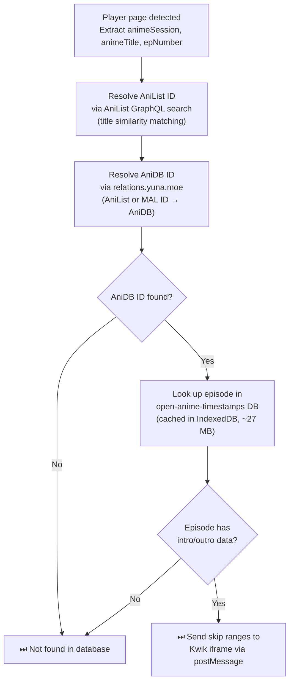

# Features (in depth)

> This page has the full technical detail for every feature. If you just want the short version, see the [main README](../README.md#what-it-does).

## Table of Contents

- [Continue Watching](#-continue-watching)
- [DUB Detector](#-dub-detector)
- [Smart Search](#-smart-search)
- [Intro / Outro Skip](#-intro--outro-skip)
- [Binge Watch](#-binge-watch)
- [Skip Wait](#-skip-wait)
- [Advanced Settings](#-advanced-settings)

---

## ▶ Continue Watching

Never lose your place again. animepahe Enhancer tracks your exact playback position for every episode you watch and surfaces a **Continue Watching** row directly on the animepahe home page.

- Automatically saves your progress every 2 seconds by default (configurable) while the video plays
- Resumes exactly where you left off when you revisit an episode
- Displays a visual progress bar on each card in the Continue Watching grid
- Each card shows the **episode's own thumbnail** (the episode-list still), not the anime poster. The extension remembers the stills animepahe already shows next to episode links as you browse (no extra requests); only if an episode was never seen it makes at most one lookup per home-page visit to animepahe's own episode-list API, and falls back to the anime poster
- Progress is written to storage at most every 5 seconds (immediately on seeks, episode changes, and when the tab is hidden or closed)
- Supports up to **24 episodes** by default in your watch history (FIFO — oldest entries are pruned automatically; this limit is configurable)
- Individual episodes can be removed with a hover-reveal ✕ button
- The entire list can be cleared in one click from the popup or the home page
- Works on the animepahe domains supported by the extension: `.pw`, `.org`, and `.com`

<a href="#top">↑ Back to top</a>

## 🎙 DUB Detector

Instantly know which episodes are available in English dub without opening them. The DUB Detector automatically scans anime listings, episode pages, and the home feed and overlays colour-coded badges:

| Location        | Badge colour                                       | Example                        |
| ---------------- | --------------------------------------------------- | ------------------------------- |
| Episode list    | Pink `DUB` badge / Orange `SUB ONLY` badge          | Dubbed or sub-only episode      |
| Home page cards | Pink `N/total` badge / Orange `SUB ONLY`            | `12/24` dubbed out of 24 total  |
| Player page     | Inline `DUB` badge / `SUB ONLY` badge on the title  | Confirmation when watching      |

Detection uses a two-method strategy with a local cache (24 hours by default, configurable) to minimise network requests:

1. **Lightweight JSON API check** — hits animepahe's `/api?m=links` endpoint
2. **HTML page fallback** — parses the play page if the API check is inconclusive

A smart **gallop-then-binary-search** algorithm is used on episode lists, since dubbed episodes are expected to form a contiguous block from the beginning of a series. After checking the first and last episodes (which can be checked together), it steps backward from the newest episode in doubling strides to bracket the dub/sub cutoff, then binary-searches within that bracket. The gallop and binary-search probes run one at a time, reducing requests to O(log n) under that ordering assumption. The delay between scan batches is configurable.

Scanning the home page's `N/total` cards is a sub-feature, toggleable directly from the DUB Detector card in the popup (default **on**) — turn it off to only scan episode lists and player pages, which uses fewer requests.

The DUB Detector's animepahe API requests are routed through a **`RequestThrottler`** — a built-in rate-limiting layer that enforces configurable concurrency limits, per-request jitter, and exponential back-off with automatic retry on HTTP 429/403 responses and Cloudflare challenge responses, keeping scans polite without sacrificing speed. Every one of these knobs is exposed in the popup's [Advanced Settings](#-advanced-settings) panel.

<a href="#top">↑ Back to top</a>

## 🔍 Smart Search

Can't find an anime because you only know its English dub title, a common nickname, or a romanized spelling that doesn't match animepahe's catalogue? Smart Search queries [AniList](https://anilist.co) for alternative titles associated with your search term, then searches animepahe for those titles — all without leaving the search bar.

- Activates automatically as you type (after a 100 ms debounce by default, with a 2-character minimum query) — no extra interaction required
- Fetches alternative titles (romaji, English, synonyms) from the AniList GraphQL API and selects the best-matching anime
- Searches animepahe for up to 3 alternate titles by default, one at a time with a 250 ms pause between searches
- Extra results are appended to the dropdown after existing results, with a pink `also matching "…"` label and a left-side accent border
- Duplicate titles already shown by animepahe's native search are automatically suppressed
- Relevance filtering uses title similarity and word overlap to limit injected results to related titles
- AniList lookup results are cached locally for 24 hours by default (storage prefix `ape_ss_`) — shares the same configurable cache-duration setting as the DUB Detector

<a href="#top">↑ Back to top</a>

## ⏭ Intro / Outro Skip

Automatically skip anime openings and endings — or show a manual Skip button when you're ready. This feature uses the community-maintained [open-anime-timestamps](https://github.com/Ellivers/open-anime-timestamps) dataset (~27 MB, cached locally in IndexedDB) to look up intro and outro timestamps per episode.

- **Two modes**, toggled directly from the Intro/Outro Skip card in the popup (not buried in the Advanced tab):
  - **Auto-skip** (off by default): The player automatically jumps past intros and outros without any interaction
  - **Manual skip** (on by default when auto-skip is off): A styled **Skip Intro** / **Skip Outro** button appears on top of the video when the playback enters an intro or outro range; clicking it seeks past the segment
- **Progress bar highlights** (on by default, toggleable as its own sub-feature): Coloured segments are drawn directly on the Kwik player's scrubber — blue for intros, orange for outros, purple for recaps — giving you a visual map of non-story content at a glance
- **ID resolution chain**: To bridge animepahe's session-based URLs to AniDB IDs, the extension queries the AniList GraphQL API for a title match, then resolves the AniDB ID via [relations.yuna.moe](https://relations.yuna.moe). Results are cached per anime session
- **Smart defaults**: When the database only provides a start time (no end), the intro/outro is extended by a configurable default duration (90 seconds by default), so the skip button always has a valid target
- **Fullscreen-aware**: The skip button and progress bar highlights work correctly in both normal and fullscreen playback, automatically reparenting into the fullscreen element
- **Status pill**: A floating pill in the bottom-right corner of the player page shows real-time lookup progress and the final result (e.g., `⏭ Intro/Outro (database): OP ✓ · ED ✓`)
- **Popup controls**: Toggle the feature on/off, see whether the timestamps database is currently cached, or clear all cached data (which forces a fresh download next time you visit a player page)

The timestamp resolution pipeline for a single episode:

<a href="#top">↑ Back to top</a>

## 🔁 Binge Watch

Automatically opens and plays the next episode when the current one ends — no clicking required. **Off by default**, since it changes browser navigation on its own.

- Listens for the video's native `ended` event inside the Kwik player
- Resolves the next episode using animepahe's own release API (the same endpoint DUB Detector uses to enumerate episodes)
- Shows a short countdown pill (`▶ Binge Watch: next episode in 5s`) before navigating — click it any time to cancel. The countdown length is tunable in Advanced Settings, and can be set to 0 to skip it entirely and jump straight to the next episode
- While the feature is on, animepahe's "Click to load" placeholder over the embed is clicked automatically on every episode page — including ones you open yourself, not just ones Binge Watch navigates to — so nothing ever sits waiting for a click
- Works purely off of the current episode's session id and animepahe's own episode ordering, so it doesn't depend on any third-party database

<a href="#top">↑ Back to top</a>

## ⏩ Skip Wait

Clicking a link in an episode page's **Download** menu opens the kwik page straight away — the 5-second `pahe.win` countdown page never appears. You still press kwik's own **Download** button as usual.

- Intercepts clicks on `pahe.win` links on episode pages and hands them to the extension's background script
- The countdown on `pahe.win` is only a timer in the page; the kwik link is already in its HTML. The background script requests that page, reads the kwik link out of it, and opens `kwik.cx/f/…` in a new tab next to your episode tab
- Nothing on kwik is touched, submitted or downloaded by the extension — it only saves you the wait
- If the kwik link can't be found, the original `pahe.win` page opens instead, so the link never just does nothing
- Ctrl / Shift / Alt / Cmd-click or middle-click a link to bypass the feature and open the original page
- On by default; switch it off from its card in the popup's Features tab

<a href="#top">↑ Back to top</a>

## ⚙ Advanced Settings

For anyone who wants to fine-tune exactly how the extension behaves, timing, caching, and request-throttling values are exposed in the popup's **Advanced** tab — no code editing required. Select a group chip to show that group's settings; only one group is displayed at a time.

| Group                  | What's tunable                                                                                                                             |
| ----------------------- | --------------------------------------------------------------------------------------------------------------------------------------------- |
| **Continue Watching**  | Max saved entries · cards shown before "Show More"                                                                                          |
| **DUB Detector**       | Cache duration · delay between scan batches · homepage batch size                                                                           |
| **Network Throttler**  | Min request interval · jitter · max concurrent requests · max retries · base backoff                                                        |
| **Smart Search**       | Minimum query length · debounce delay · max alternate titles queried · synonym query delay                                                  |
| **Player**             | Progress-save interval                                                                                                                       |
| **Intro / Outro Skip** | Skip button auto-hide · poll interval · default OP/ED duration · timestamp DB refresh interval · ID lookup cache duration |
| **Binge Watch**       | Countdown before next episode (0 = skip it entirely)                                                                                        |

- Auto-skip and progress-bar highlights are no longer here — they're sub-feature toggles on the Intro/Outro Skip card itself (see above), since they're everyday options, not tuning knobs.

- Tap a setting's **ⓘ** control to show its plain-language description
- Each setting has a numeric stepper clamped to a sane range; a **Default N** reset button appears when its value differs from the default
- Edits are staged as you change them — nothing is saved until you press **Apply** at the bottom of the tab
- **Reset all** restores every tunable above to its default in one click — without touching your feature toggles
- Changes persist across browser restarts and (like the feature toggles) need a page reload to take effect

<a href="#top">↑ Back to top</a>

