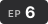
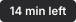
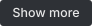
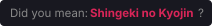

# Usage Guide

> Step-by-step instructions for every feature. For a quick overview instead, see the [main README](../README.md), or see [docs/FEATURES.md](FEATURES.md) for full technical details.

## Table of Contents

- [Continue Watching](#continue-watching)
- [DUB Detector](#dub-detector)
- [Smart Search](#smart-search)
- [Intro / Outro Skip](#intro--outro-skip)
- [Binge Watch](#binge-watch)
- [Skip Wait](#skip-wait)
- [Popup Settings Panel](#popup-settings-panel)

---

##  Continue Watching

When you watch an episode on animepahe:

1. The extension automatically tracks your playback position every 2 seconds (by default) and coalesces storage writes at most every 5 seconds (or immediately when you seek, switch episodes, or hide/close the tab). No manual action is required.
2. Only the latest watched episode per anime series is kept (up to **24 shows** by default), ordered with the most recently watched series first.
3. The next time you visit the **animepahe home page**, a **Continue Watching** shelf appears directly above the **Latest Releases** grid, shown as a row of six small thumbnails by default, matching the site's heading font and card spacing. Prefer the old look (portrait poster cards with the title underneath)? Open the popup, expand **Continue Watching** and switch **Classic style** on.
4. Each 16:9 card displays:
    - The **episode's own thumbnail** (harvested passively as you browse episode listings, with a single release-API lookup per home-page visit if an episode still wasn't seen yet, or the anime poster as a final fallback)
    - A glowing pink progress bar () along the bottom edge showing how far through the episode you are
    - The anime title in the bottom-left and the episode badge () in the bottom-right
    - On hover or keyboard focus (the remove button is always visible in the default style): a centered pink circular **play button** (), a top-left **time-remaining badge** (, or `Almost done` when under 60 seconds remain), and a top-right **remove button** (, always visible on touch devices)
5. Click any card to jump directly back to that episode; the video player will automatically seek to your saved timestamp.
6. Click the top-right **✕** button on a card to remove that series from your list.
7. Use **Show more / Show less** () in the shelf header (next to the pink entry count pill ) when you have more than 6 entries (configurable in Advanced Settings). 6 entries fill exactly one row of the default style.
8. Click **Clear all** () in the shelf header to open the inline confirmation dialog (`Clear all N episodes from Continue Watching?`), or use **Clear list** inside the Continue Watching row in the popup.

<a href="#top">↑ Back to top</a>

##  DUB Detector

The DUB Detector runs automatically in the background on three page types (after waiting for any Cloudflare interstitial check and the page's own load to finish):

**Anime episode list page (`/anime/{session}`):**

- Once episode cards appear on the page, they are scanned using a sequential gallop-then-binary-search algorithm.
- Dubbed episodes receive a solid brand-pink **DUB** badge () with a microphone icon in the top-right corner of their card; sub-only episodes receive a dark frosted-glass **SUB ONLY** badge () with an amber dot.
- Next to the page's `Episodes (N)` heading, an inline summary () shows the total dubbed count (`6 of 9 dubbed`) alongside a segmented pink/grey progress bar.
- A rich status toast in the bottom-right corner displays a pink progress ring () and live percentage while scanning (`Scanning dubs 67%`), resolving to a pink checkmark badge ( `6 episodes dubbed`) or an amber dot ( `No dub found`). If rate-limited, it shows `Dub scan paused (rate limited)` without applying false `SUB ONLY` badges and retries after 90 seconds.
- The scan re-runs automatically when the episode list is paginated or updated via AJAX.

**Player page (`/play/{animeSession}/{epSession}`):**

- Checks the active episode on load while showing `Checking dub` in the bottom-right status toast.
- Appends an inline pink **DUB** badge () or dark glass **SUB ONLY** badge () directly next to the episode's `<h1>` heading, and updates the toast to `Dub available` or `Sub only`.

**Home page (Latest Releases grid):**

- Enabled by default and toggleable via the **Scan homepage cards** sub-option inside the DUB Detector row in the popup.
- While a card is being checked on a cache miss, it shows a temporary dark glass **SCANNING** spinner badge ().
- Cards with dubbed episodes receive a pink badge () showing the microphone icon, `dubbed/total` count (e.g., `6/10`), and a visual coverage meter bar. Sub-only series receive the dark glass **SUB ONLY** badge ().
- Scanning is batched (2 cards at a time by default) to avoid rate-limiting, automatically skipping the inter-batch delay when results are cached or have no dub.

**Cache:** DUB results are cached for **24 hours by default**. Stale entries are garbage-collected automatically on startup. Batch size, batch delay, and cache duration are configurable in Advanced Settings, and you can force-clear the cache from the popup.

<a href="#top">↑ Back to top</a>

##  Smart Search

Smart Search activates automatically while you type in the animepahe search bar — no extra steps are needed:

1. Start typing any query (at least 2 characters by default) in the search bar. After a **400 ms debounce** by default (configurable in Advanced Settings), Smart Search runs alongside the native search.
2. animepahe's regular results appear as normal. Smart Search queries AniList for alternative titles (English, romaji, and synonyms) associated with your term.
3. Smart Search queries animepahe's search API for up to **3 alternate titles** by default (one at a time with a 250 ms pause), routing requests through the shared throttler with priority ahead of background DUB scans and caching animepahe search responses in memory for 5 minutes. If you keep typing, stale synonym lookups are aborted automatically.
4. Matching extra results () are appended below the native results with a 3 px pink left border, circular poster thumbnail, metadata line (`Type - N Eps - Season - Year`), and a pink italic _also matching "…"_ label.
5. If animepahe's native search returns **0 results** and AniList finds a likely match, Smart Search inserts a clickable **Did you mean?** banner () at the top of the dropdown — click it to search for that title immediately.
6. Click any result row (native or injected) to navigate to that anime's page as normal.

**Cache:** AniList lookup results are cached in `chrome.storage.local` (`ape_ss_` prefix) for **24 hours by default** (configurable in the Advanced tab). You can force-clear the cache from the popup.

<a href="#top">↑ Back to top</a>

##  Intro / Outro Skip

The Intro / Outro Skip feature activates automatically on the player page (`/play/{animeSession}/{epSession}`):

1. When you navigate to a player page, the extension extracts the anime title and episode number from the page.
2. It resolves the anime to an AniDB ID (via AniList search → `relations.yuna.moe`) and looks up intro/outro/recap timestamps for that episode in the cached `open-anime-timestamps` database. A status pill in the bottom-right corner shows progress (`⏭ Resolving anime…` → `⏭ Looking up timestamps…`).
3. If timestamps are found, a result pill appears (e.g., `⏭ Intro/Outro (database): OP ✓ · ED ✓`) and the skip ranges are sent to the Kwik player iframe.
4. In **manual mode** (default): A styled **Skip Intro** or **Skip Outro** button () appears overlaid in the bottom-right corner of the video (in both normal and fullscreen playback) when playback enters an intro or outro range. Click it to jump past the segment. The button auto-hides after **8 seconds** by default (configurable) and reappears when you move your mouse.
5. In **auto-skip mode** (opt-in via the **Auto-skip automatically** sub-option on the Intro / Outro Skip card in the popup): The player automatically seeks past intros and outros as soon as playback enters the range, with a 1-second grace period after manual seeks so you can still scrub into an OP/ED if you want to.
6. **Progress bar highlights** (on by default, toggleable via **Highlight on progress bar** on the Intro / Outro Skip card): Coloured segments are drawn directly inside the Kwik player's scrubber — **blue** () for intros, **orange** () for outros, and **purple** () for recaps.
7. If the title or episode cannot be matched to timestamp data, nothing is skipped for that episode and the status pill reports `not found in database` or `no data for this episode`.

**Data sources and caching:**

- The `open-anime-timestamps` database (~27 MB) is downloaded from GitHub and cached in **IndexedDB** (`ape_intro_skip`), with lightweight metadata in `chrome.storage.local` (`ape_is_db_meta`). It is refreshed on a configurable schedule (**7 days / 168 hours** by default) using conditional GET with `If-None-Match` (ETag) headers to avoid re-downloading unchanged data.
- AniList → AniDB ID mappings are cached per anime session in `chrome.storage.local` (`ape_isid_v1_{session}`, configurable TTL, default **7 days / 168 hours**).
- You can see whether the database is currently cached, or clear all cached data, from the Intro / Outro Skip row in the popup.

<a href="#top">↑ Back to top</a>

##  Binge Watch

Binge Watch auto-loads the player and auto-plays the next episode when the current one ends. It's **off by default** since it navigates your browser on its own — turn it on from its row in the popup's Features tab.

1. While Binge Watch is on, animepahe's `"Click to load"` placeholder (`div.click-to-load`) over the video embed is clicked automatically on **every** episode page you land on — including ones you open yourself from an episode list — and Kwik's player starts playback automatically.
2. When the video hits its native `ended` event inside Kwik, the extension shows `🔁 Binge Watch: finding next episode…` and looks up the next episode via animepahe's own release listing (walking across paginated release pages if needed).
3. A clickable countdown pill () appears in the bottom-right corner. Click it any time before the timer finishes to cancel and stay on the current episode (`🔁 Binge Watch: cancelled`).
4. If you don't cancel, the browser navigates to the next episode automatically once the countdown ends.
5. If there is no next episode (you're on the latest one), the pill shows `🔁 Binge Watch: no next episode found` and playback ends normally.

**Tuning:** The countdown length is configurable in the Advanced tab (`Countdown before next episode`, under `Binge`) and can be set to **0** to skip the countdown pill entirely and jump straight to the next episode.

<a href="#top">↑ Back to top</a>

##  Skip Wait

Skip Wait removes the `pahe.win` countdown page from the download flow. It's **on by default** and can be switched off from its row in the popup's Features tab.

1. Open an episode player page and click the **Download** menu as usual.
2. Left-click a quality link (for example `SubsPlease · 1080p`). A status pill appears in the bottom-right corner (`⏩ Skip Wait: getting link (SubsPlease · 1080p)…`).
3. A new tab opens directly on the `kwik.cx/f/…` page right next to your episode tab () — no 5-second `pahe.win` wait. Click Kwik's **Download** button there to save the file as usual.
4. If the extension can't find the Kwik link (or the request times out after 15 seconds), it opens the original `pahe.win` page instead (`⏩ Skip Wait: couldn't find the link, opened the normal page`).

**Want the original behaviour for one click?** Hold **Ctrl**, **Shift**, **Alt**, or **Cmd** while clicking (or **middle-click**) and the link opens the normal `pahe.win` page.

<a href="#top">↑ Back to top</a>

## Popup Settings Panel

Click the extension icon in the browser toolbar to open the settings popup (`400px` wide, sized to fit its content with no inner scrollbar). It is organized into three tabs below the header and status timeline strip:

**Features tab** — one row per feature, each with its own custom SVG icon and accent colour. The timeline strip under the header lights one proportional segment per enabled feature (for example, `5 OF 6 ACTIVE` by default). Click any feature row to expand it (accordion-style, one row open at a time) and:

- View a live stat chip (`N items` for Continue Watching, `N cached` for DUB Detector and Smart Search, or `Database cached` / `N IDs cached` / `Not cached` for Intro / Outro Skip)
- Clear that feature's saved list or cache with one click (`Clear list` / `Clear cache`)
- Toggle feature sub-options right on the card:
    - **Continue Watching**: `Classic style` (default **Off**; turn it On for the old poster-card look — the shelf updates instantly, no reload needed)
    - **DUB Detector**: `Scan homepage cards` (default **On**)
    - **Intro / Outro Skip**: `Auto-skip automatically` (default **Off**) and `Highlight on progress bar` (default **On**)

The switch on the right of each row turns that entire feature on or off.

**Advanced tab** — 22 tunable settings organized into 7 group chips (`Continue`, `DUB`, `Network`, `Search`, `Player`, `Skip`, `Binge`):

- Select a group chip to display only that group's settings
- Each setting row has a numeric stepper (`−` / `+` buttons and direct number input), an **`i`** button that shows its plain-language description in the help box below the list, and a blue **`Default N`** link that appears whenever its value differs from the default
- Edits are staged (marked with a pink dot on both the row and the group chip) until you press **Apply** — nothing is saved until then
- **Reset all** restores every advanced tunable to its default value without touching your feature toggles

**Links tab** — a hero card for animepahe (with the real animepahe wordmark), links to the GitHub source repository and issue tracker, and a recommended companion tool, [MalSync](https://malsync.moe/) (with its official logo), for syncing watch progress to MyAnimeList, AniList, and Kitsu.

> After toggling a feature or applying an advanced setting, reload the animepahe page for changes to take effect. The popup displays a `Reload page to apply` notice in the timeline bar automatically.

<a href="#top">↑ Back to top</a>

