# Documentation assets

This folder holds the SVG icons and UI badge graphics embedded in
[feature reference](/docs/FEATURES.md), [usage guide](/docs/USAGE.md), and
[README](/README.md).

Because [`build-zip`](/.github/actions/build-zip/action.yml) excludes the entire
`docs/` directory (`"docs/*"`), none of these documentation assets are ever
bundled into the Firefox or Chromium extension `.zip` packages.

## Contents

*   [Feature tile icons](#feature-tile-icons)
*   [Browse controls](#browse-controls)
*   [On-page UI icons and badges](#on-page-ui-icons-and-badges)

## Feature tile icons

Derived from [`popup/components/icons/`](/popup/components/icons) and
[`popup/components/features/feature-config.js`](/popup/components/features/feature-config.js):

| Asset                   | Preview                                           | Source Component                | Accent on tile         |
| :---------------------- | :-----------------------------------------------: | :------------------------------ | :--------------------- |
| `continue-watching.svg` |        | `ContinueWatchingIcon.js`       | `#ff4d94` on `#2b0012` |
| `dub-detector.svg`      |                  | `DubDetectorIcon.js`            | `#ff4d94` on `#2b0012` |
| `smart-search.svg`      |                  | `SmartSearchIcon.js`            | `#ff4d94` on `#2b0012` |
| `intro-skip.svg`        |              | `IntroSkipIcon.js`              | `#ff4d94` on `#2b0012` |
| `binge-watch.svg`       |                    | `BingeWatchIcon.js`             | `#ff4d94` on `#2b0012` |
| `skip-wait.svg`         |                        | `SkipWaitIcon.js`               | `#ff4d94` on `#2b0012` |
| `advanced-settings.svg` | 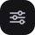       | Advanced Settings tab           | `#b4b4bf` on `#151518` |
| `shield.svg`            |  | `challenge.js` + `throttler.js` | `#ff4d94` on `#2b0012` |

## Browse controls

| Asset                | Preview                         | Control                 |
| :------------------- | :-----------------------------: | :---------------------- |
| `browse-search.svg`  |     | Browse title search     |
| `browse-chevron.svg` |  | Browse filter dropdown  |
| `browse-grid.svg`    |    | Browse poster grid      |
| `browse-list.svg`    |    | Browse list view        |
| `browse-library.svg` |   | Browse Library bookmark |

## On-page UI icons and badges

Derived from [`content/helpers/icons.js`](/content/helpers/icons.js),
[`content/helpers/pill.js`](/content/helpers/pill.js),
[`content/iframe-player.js`](/content/iframe-player.js), and
[`content/features/css/`](/content/features/css):

| Asset                   | Preview                                         | Feature / Helper                                                               |
| :---------------------- | :---------------------------------------------: | :----------------------------------------------------------------------------- |
| `cw-count.svg`          |                               | Continue Watching — `.ape-cw-count` header pill                                |
| `cw-btn-more.svg`       | 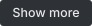                   | Continue Watching — `#ape-cw-toggle` button                                    |
| `cw-btn-clear.svg`      |                   | Continue Watching — `#ape-cw-clear` button                                     |
| `play.svg`              |                                | Continue Watching — `playIcon` in `.ape-cw-play`                               |
| `close.svg`             |                             | Continue Watching — `closeIcon` in `.ape-cw-remove-btn`                        |
| `cw-time-left.svg`      | 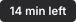                | Continue Watching — `.ape-cw-left` time-remaining badge                        |
| `cw-ep-badge.svg`       | 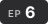                        | Continue Watching — `.ape-cw-ep` badge                                         |
| `cw-prog-bar.svg`       |                 | Continue Watching — `.ape-cw-prog-bar`                                         |
| `mic.svg`               |                                  | DUB Detector — `micIcon` in `content/helpers/icons.js`                         |
| `badge-dub.svg`         |                            | DUB Detector — `.ape-dub-badge-ep` / `.ape-dub-inline`                         |
| `badge-sub-only.svg`    |                  | DUB Detector — `.ape-sub-badge-ep` / `.ape-sub-badge-home` / `.ape-sub-inline` |
| `badge-dub-home.svg`    |                      | DUB Detector — `.ape-dub-badge-home` with `.ape-dub-meter`                     |
| `badge-scanning.svg`    |                  | DUB Detector — `.ape-dub-spin` home card spinner                               |
| `badge-dub-summary.svg` | 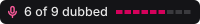         | DUB Detector — `.ape-dub-summary` with `.ape-dub-seg`                          |
| `progress-ring.svg`     |              | Status Toast — `.ape-pill-ring` (`showStatus` progress state)                  |
| `check.svg`             |                              | Status Toast — `.ape-pill-ok` (`checkIcon` in `showStatus` success state)      |
| `neutral-dot.svg`       |                  | Status Toast — `.ape-pill-dot` (`showStatus` empty/paused state)               |
| `ss-dym-badge.svg`      | 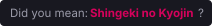               | Smart Search — `.ape-ss-dym` banner                                            |
| `ss-extra-row.svg`      |            | Smart Search — `li[data-ape-ss-extra="1"]` row                                 |
| `skip-btn-icon.svg`     |                  | Intro / Outro Skip — `.ape-is-skip-icon`                                       |
| `badge-skip-intro.svg`  |              | Intro / Outro Skip — `.ape-is-skip-btn`                                        |
| `scrubber-intro.svg`    | 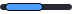           | Intro / Outro Skip — `.ape-is-hl-intro` (`#4f9dff`)                            |
| `scrubber-outro.svg`    | 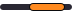           | Intro / Outro Skip — `.ape-is-hl-outro` (`#ff8a1f`)                            |
| `scrubber-recap.svg`    | 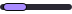           | Intro / Outro Skip — `.ape-is-hl-recap` (`#a98bff`)                            |
| `pill-bw-countdown.svg` |  | Binge Watch — countdown pill with Cancel action (`showAction`)                 |
| `pill-sw-opened.svg`    |     | Skip Wait — completion pill (`showAction`)                                     |
| `cw-title.svg`          | 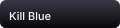                      | Continue Watching — `.ape-cw-title` series title over the bottom gradient      |
| `toggle-autoskip.svg`   | 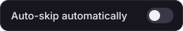        | Intro / Outro Skip — popup **Auto-skip automatically** switch (off)            |
| `pill-is-ready.svg`     |            | Intro / Outro Skip — `Skip data ready` pill (`showAction`)                     |
| `pill-is-none.svg`      |                | Intro / Outro Skip — `No skip data` pill (`showAction`)                        |
| `pill-bw-finding.svg`   |     | Binge Watch — `Finding next episode` pill                                      |
| `pill-bw-cancelled.svg` |  | Binge Watch — `Binge Watch cancelled` pill                                     |
| `pill-bw-playing.svg`   |     | Binge Watch — `Playing next episode` pill                                      |
| `pill-bw-last.svg`      |        | Binge Watch — `Last episode reached` pill                                      |
| `pill-sw-getting.svg`   |             | Skip Wait — `Getting link` pill with the option label                          |
| `pill-sw-busy.svg`      |   | Skip Wait — `Already working on a link` pill                                   |
| `pill-sw-fallback.svg`  |  | Skip Wait — fallback pill when no kwik link is found                           |
